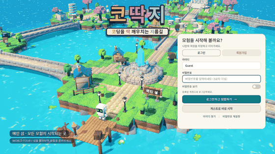
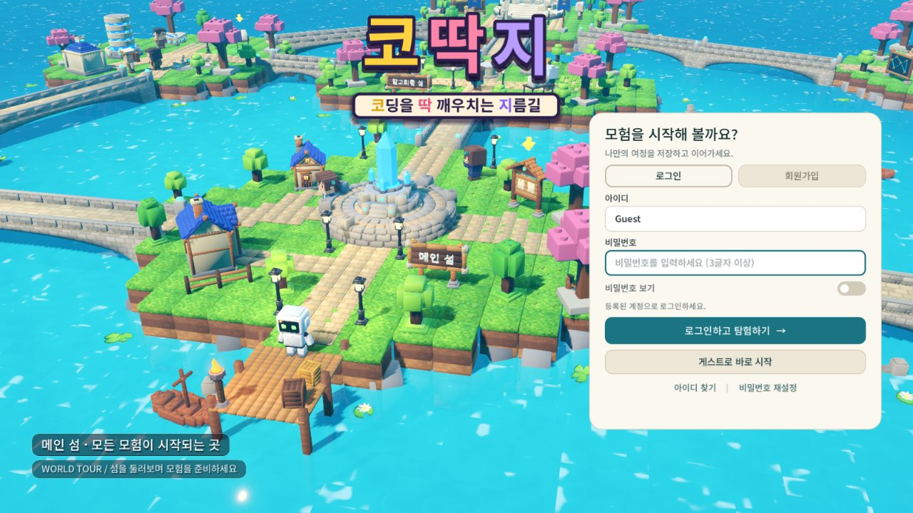
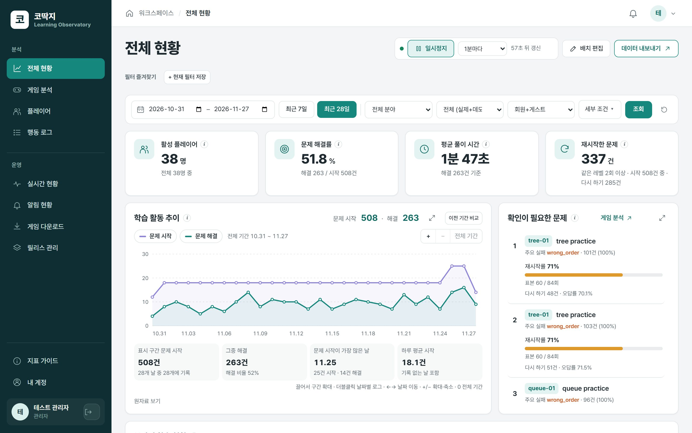
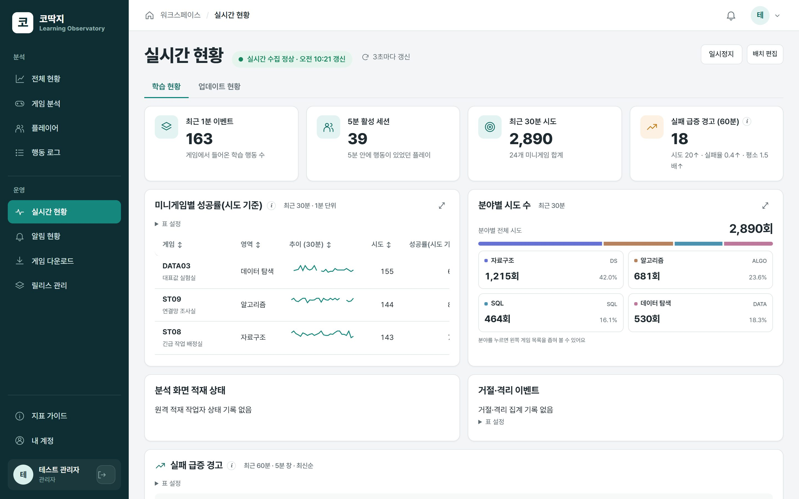
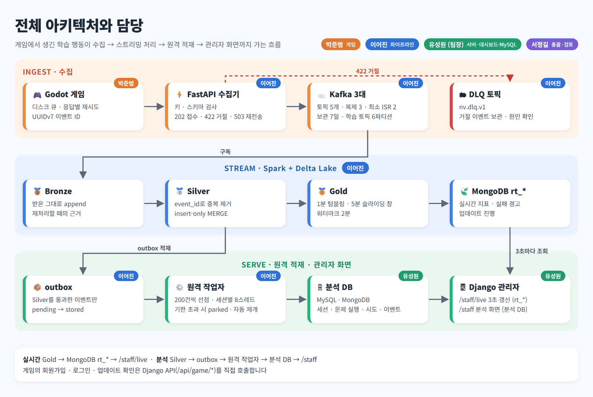
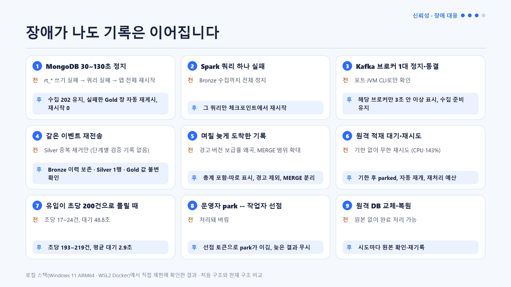
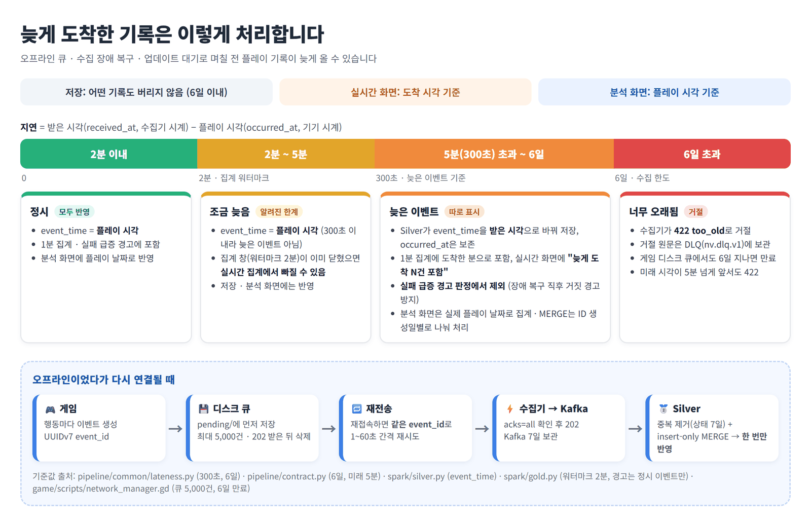
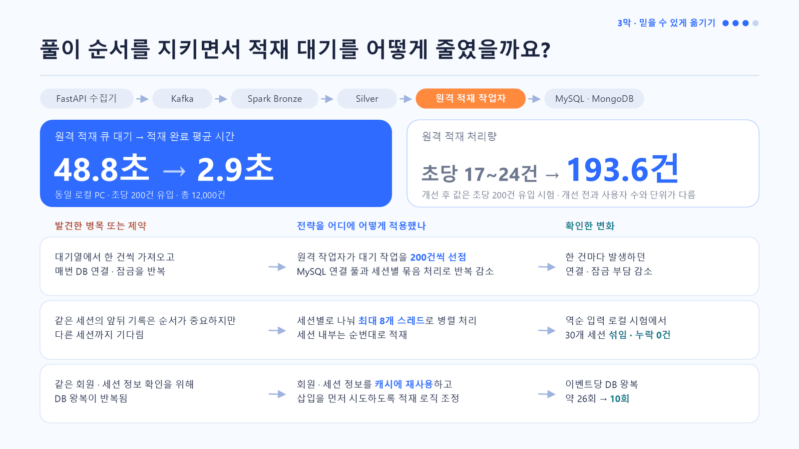
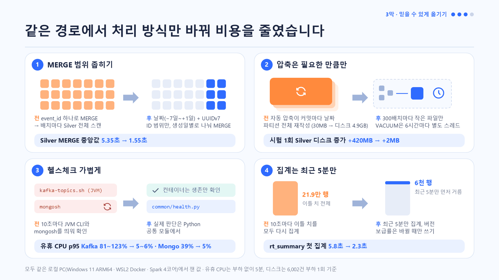

<div align="center">


# 코딱지

### 코딩의 원리를 딱 깨우치는 지름길

**외우지 말고, 움직여라. 코딩이 딱 이해된다!**

게임을 하다 보면 자료구조·알고리즘·SQL이 손에 익고, 그 모든 플레이가 실시간 데이터 파이프라인을 타고 학습 진단이 됩니다.


[**▶ itch.io에서 플레이**](https://kingdoms1212.itch.io/kkotackji) &nbsp;·&nbsp; [**📊 관리자 대시보드 둘러보기**](#한눈에-보기) &nbsp;·&nbsp; [**🏗 아키텍처**](#아키텍처) &nbsp;·&nbsp; [**🎬 홍보 숏츠**](https://youtube.com/shorts/y_Be5HSoYxk)




</div>

https://github.com/user-attachments/assets/6a87fe49-bf94-4d1b-82d7-96e51b00c655

<p align="center"><sub>30초 홍보 숏츠 (▶ 누르면 소리와 함께 재생) · <a href="https://youtube.com/shorts/y_Be5HSoYxk">YouTube에서 보기</a></sub></p>

## 숫자로 보는 코딱지

| 🎮 미니게임 | 🏝 3D 월드 | ⚡ 실시간 처리 | ⏱ 대시보드 반영 |
|:---:|:---:|:---:|:---:|
| **24종**<br><sub>자료구조·알고리즘·SQL·데이터</sub> | **섬 7개**<br><sub>다리로 연결된 월드</sub> | **초당 200건**<br><sub>유입을 그대로 따라감</sub> | **평시 10~18초**<br><sub>게임 행동 → 관리자 화면</sub> |
| 🚀 **원격 적재 약 9배**<br><sub>초당 17~24건 → 219건</sub> | 🔁 **Silver MERGE 약 3.5배**<br><sub>5.35초 → 1.55초</sub> | 🪶 **쉬는 중 Kafka CPU**<br><sub>p95 81~123% → 5~6%</sub> | 🛡 **MongoDB 130초 정지**<br><sub>수집 계속 · Spark 재시작 0회</sub> |

<sub>모든 수치는 같은 로컬 PC(Windows 11 ARM64, WSL2 Docker, Spark 4코어)에서 직접 잰 값입니다. 운영 환경 수치가 아닙니다. 근거: [구조 비교와 최적화](docs/presentation/NODEVERSE_파이프라인_구조비교_최적화.md), [Silver MERGE·압축 보완](docs/changes/2026-11-21_silver_merge_scaling.md)</sub>

## 이 프로젝트가 특별한 이유

- 🛡 **장애에 강합니다.** 게임은 기록을 디스크 큐에 먼저 쓰고, 수집기는 Kafka 복제가 끝난 뒤에만 받았다고 답합니다. Spark가 멈춰도 Kafka 7일 보관과 쿼리별 체크포인트로 이어서 처리하고, 같은 기록이 여러 번 와도 한 번만 반영합니다. → [장애 복구](#장애-복구)
- ⚡ **실시간입니다.** 수집 API → Kafka → Spark Structured Streaming + Delta Lake(Bronze·Silver·Gold) → MongoDB를 거쳐, 게임 속 행동이 십몇 초 안에 관리자 실시간 화면에 올라옵니다. 늦게 도착한 기록까지 따로 다룹니다. → [지연 이벤트](#지연-이벤트)
- 🧠 **학습을 진단합니다.** 게임별 해결률·오답률·재시작·다시 하기로 "어느 게임, 어느 조작에서 막히는지"를 데이터로 보여 줍니다. 되돌리기처럼 판정이 없는 조작은 오답률에서 뺍니다. → [학습 지표](#학습-지표)
- 🎮 **진짜 게임입니다.** Godot 3D 섬 월드와 미니게임, 회원가입·클라우드 세이브, 시작할 때 확인하는 자동 업데이트·리소스 팩까지 갖췄습니다. → [게임 설명서](game/README.md)

## 한눈에 보기

| 3D 월드 로비 | 스택 스테이지 (DS-03) |
|:---:|:---:|
|  |  |
| **관리자 전체 현황** (재시작·다시 하기·오답률) | **실시간 현황** (성공률·실패 급증 경고) |
|  |  |

<sub>대시보드 화면은 로컬에서 합성 데모 데이터로 띄운 모습입니다.</sub>

---

## 빠른 시작

MLO 2기 3차 프로젝트 1팀 통합 저장소입니다. 서비스 이름은 **코딱지**이고, 이전 이름은 NODEVERSE입니다.
게임·관리자 대시보드·관측소·소개 페이지의 화면 표기는 코딱지입니다. 저장소·폴더·파일 이름과 코드 식별자(`nodeverse.code-workspace`, `NodeverseWorld.tscn`, `nodeverse_logs`, 내보내기 파일 `NODEVERSE.exe` 등)에는 이전 이름이 남아 있습니다.

```bash
git lfs install        # game/ 의 Godot 에셋은 LFS로 받습니다
git clone https://github.com/encore-ai-campus/mlo-02-p3-team1.git
code mlo-02-p3-team1/nodeverse.code-workspace
```

> 처음 받는 사람은 [설치 가이드](docs/SETUP_GUIDE.md)부터 보세요. 한 PC에서 전체를 띄우려면 저장소 루트의 **`전체실행.cmd`** 를 더블클릭하세요(중지: `전체중지.cmd`, 상태: `상태확인.cmd`, DB 조회: `DB조회화면.cmd`·`DB조회_몽고.cmd`·`DB조회_MySQL.cmd`, 자세히: [Windows 로컬 실행 가이드](docs/LOCAL_RUN_WINDOWS_ARM.md)).

---

## 구성과 팀

코딱지는 **자료구조·알고리즘·SQL·데이터 탐색**을 3D 섬 월드와 2D 미니게임으로 배우는 교육용 게임 플랫폼입니다.
플레이어가 게임에서 하는 학습 행동(문제 시작, 조작 성공·실패, 힌트, 시도 결과)을 이벤트로 수집하고,
실시간 파이프라인에서 검증·집계해 관리자 대시보드에서 게임별 학습 현황과 어려운 게임을 확인합니다.
게임·파이프라인·서버를 폴더별로 나눈 모노레포이며, 각 폴더 설명서에 실행 방법과 상세 설명이 있습니다.

| 구성 | 한 줄 설명 | 설명서 |
|---|---|---|
| 게임 `game/` | Godot 4.7 클라이언트. 섬 7개로 된 3D 월드와 미니게임(실습 23종 + 보너스, 종합 도전 2종), 학습 이벤트 송신, 회원·클라우드 세이브, 자동 업데이트, 소개 웹사이트 원본 | [게임 설명서](game/README.md) |
| 파이프라인 `pipeline/` | 수집 API → Kafka → Spark Structured Streaming + Delta Lake(Bronze·Silver·Gold) → MongoDB, 원격 DB 적재, 읽기 전용 관측소 | [파이프라인 설명서](pipeline/README.md) |
| 서버 `server/` | Django 관리자 대시보드, 게임 회원·세이브 API, 배포·업데이트 관리, 소개 웹사이트 | [서버 설명서](server/README.md) |
| 데이터 규약 `contracts/` | 세 파트 공통 이벤트 형식·Kafka 토픽 | [데이터 규약](contracts/README.md) |
| 문서 `docs/` | 팀 공통 문서·보고서·아키텍처 그림·저장소 폴더 구조 | [문서 목차](docs/README.md) |

**팀**

| 이름 | 역할 |
|---|---|
| 유성원 (팀장) | 서버·대시보드, MySQL 저장·조회 |
| 서정길 | 총괄·검토 |
| 박준범 | 게임 |
| 이어진 | 파이프라인: 수집·전달·정제·집계·MongoDB 저장 |



- 작업 브랜치는 `game/…`, `pipeline/…`, `server/…`, `contracts/…`, `docs/…` 접두어를 쓰고 PR로 `main`에 합칩니다. `contracts/`를 바꾸는 PR은 세 파트 모두 리뷰합니다.
- `.env`·API 키는 절대 커밋하지 않습니다. `.env.example`만 올립니다.

---

## 아키텍처


[원본 SVG](docs/architecture/pipeline-architecture-2026-11-25.svg) · [한 장짜리 개요](pipeline/docs/architecture.png) · [보완 전 데이터 흐름 그림](docs/architecture/data-flow-2026-11-20.png) · [데이터 흐름과 남은 과제](docs/DATA_FLOW_AND_GAPS.md) · [PC별 배포 구성과 포트](docs/SETUP_GUIDE.md#7-pc별-배포-구성과-포트)

| 순서 | 위치 | 일어나는 일 |
|---|---|---|
| ① | 게임 PC | 학습 행동 → 이벤트 생성 → 디스크 큐 → `POST /v2/events` |
| ② | 파이프라인 PC (.81) | 게이트웨이 :8000 → 수집기가 검사 후 Kafka에 기록, 202 응답 |
| ③ | 〃 | Spark Bronze(원본) → Silver(검증·중복 제거) → Gold(1분·5분 집계) |
| ④ | 〃 | Gold → 로컬 MongoDB `rt_*`, Silver → outbox |
| ⑤ | 〃 → DB PC (.167) | remote-writer가 MySQL `game_members`, MongoDB 세션·시도·이벤트와 `rt_*` 사본으로 적재 |
| ⑥ | 대시보드 PC (.29) | Django가 MySQL·MongoDB를 읽어 `/staff/` 화면에 표시 |
| ⑦ | 파이프라인 PC | 관측소(:8011)가 Spark 진행 파일·로컬 MongoDB를 읽어 처리 상태와 경고 표시 |
| ⑧ | 게임 ↔ Django | 회원가입·로그인·클라우드 세이브·업데이트 확인은 직접 호출 |

---

## 학습 지표

지표는 **미니게임 하나** 단위로, 그 게임의 레벨을 모두 합쳐 계산합니다. 한 번의 **실행**은 게임에 들어가서 나올 때까지, 레벨 1회 도전이 **시도**, 그 안의 행동 하나가 **조작**입니다.

| 지표 | 계산 방식 |
|---|---|
| 해결률 | 완료한 실행 ÷ 시작한 실행 |
| 오답률 | 잘못된 조작 ÷ 판정된 조작. 다시 시작(R)·되돌리기·코딩테스트 토큰 입력은 빼고, 판정된 조작이 없으면 — |
| 재시작 | 게임 완료 전, 실패했거나 끝내지 않은 레벨을 다시 시작한 실행 (막힘). 깬 레벨 연습은 세지 않음 |
| 다시 하기 | 이미 완료한 게임(별 개수 무관)을 다시 푼 실행 (이해 재확인) |

실시간 화면의 성공률·실패율은 **시도 기준**입니다. 완료 전 다시 시작(R)과 목숨 소진도 실패에 들어가므로 조작 기준인 오답률과 다릅니다. 분야별 화면은 지금은 해결률만 보여 줍니다. 전체 정의(힌트 뒤 성공, 주의 목록 순서, ST10 처리, 실패 급증 경고 기준)는 [학습 지표 전체 정의](server/README.md#학습-지표-정의)에 있습니다.

---

## 신뢰성

### 장애 복구

어느 한 단계가 멈춰도 앞 단계가 기록을 보관하고, 다시 살아나면 같은 ID로 이어서 처리합니다. 재전송은 여러 번 일어날 수 있지만 event_id·내용 해시·insert-only MERGE로 결과가 한 번만 반영되게 만듭니다(분산 트랜잭션 기반 exactly-once를 보장한다는 뜻은 아닙니다).

| 장애 지점 | 대응 |
|---|---|
| 게임 PC 네트워크 끊김·강제 종료 | 이벤트를 먼저 디스크 큐(`user://telemetry/pending/`)에 쓰고 202를 받은 뒤에만 지웁니다. 끊기거나 종료돼도 다음 실행 때 같은 event_id로 다시 보냅니다(1~60초 간격 재시도, 최대 5,000건). 4xx는 그 건만 `rejected/`로 옮기고, 401은 보관한 채 재시도합니다 |
| 수집기 · Kafka | Kafka `acks=all` 확인 뒤에만 202를 줍니다. Kafka가 응답하지 않으면 5초 안에 503을 돌려주고 게임이 다시 보냅니다. 복제 3·최소 ISR 2라 브로커 1대가 멈춰도 수집은 계속됩니다 |
| Spark | 쿼리마다 체크포인트가 있고 Kafka가 7일 보관하므로, Spark가 멈췄다 다시 뜨면 마지막 처리 위치부터 이어 갑니다. 감독 루프가 실패한 쿼리만 체크포인트에서 다시 시작하고, 10분 안에 5회를 넘으면 컨테이너를 재시작합니다 |
| 중복 | 같은 event_id 재전송은 Silver 상태 저장소(기본 7일)와 insert-only MERGE로 걸러져 행이 늘지 않습니다. 같은 ID에 다른 내용이 오면 `silver.quarantine`에 격리합니다 |
| 로컬 MongoDB (`rt_*`) | 쓰기를 5회 재시도하고, 끝내 실패한 창은 기록해 두었다가 Gold Delta에서 다시 게시합니다. 로컬 시험에서 MongoDB를 130초 멈춰도 수집은 계속됐고 Spark 재시작은 0회였습니다 |
| 원격 적재 (outbox → 원격 MySQL·MongoDB) | 상태(pending·processing·stored·retrying·waiting_context·parked·blocked·quarantined)를 outbox에 남깁니다. 일시 오류는 `retrying`, 기한·횟수를 넘으면 `parked`로 두고 조건이 맞으면 자동 재개합니다. 세션 순번 순서를 지키며 다른 세션은 막지 않습니다 |
| 거절된 기록 (DLQ) | 422 원문을 `nv.dlq.v1`에 남깁니다. 계약 호환 문제로 거절된 기록은 [DLQ 복구 도구](pipeline/tools/recover_state_dlq.py)로 계획을 만든 뒤 같은 ID로 다시 보낼 수 있습니다(2026-11-25에 45건 복구, 기존 기록 변경 0건) |
| 확인 | 관측소(:8011)가 쿼리 중단, 처리·배치 지연, 적재 대기·중단을 표시하고 경고·복구 이력을 남깁니다 |



자세히: [장애 복구 보고](pipeline/docs/RECOVERY_2026-11-25.md), [신뢰성 보완 기록](docs/changes/2026-11-20_pipeline_reliability.md), [구조 비교와 최적화](docs/presentation/NODEVERSE_파이프라인_구조비교_최적화.md)

### 지연 이벤트

며칠 전 플레이 기록이 늦게 도착해도 버리지 않습니다. 실시간 화면은 **도착 시각**, 분석 화면은 **플레이 시각** 기준으로 세고, 지연 정도에 따라 아래처럼 다르게 다룹니다. → [지연 이벤트 상세](pipeline/README.md#지연-이벤트-처리)



### 원격 적재 지연 단축

풀이 순서(세션 안 순번)는 지키면서 원격 적재 대기를 48.8초 → 2.9초로 줄였습니다(로컬 실측, 초당 200건 유입). → [구조 비교와 최적화](docs/presentation/NODEVERSE_파이프라인_구조비교_최적화.md)



### Delta 튜닝

같은 처리 경로에서 처리 방식만 바꿔 비용을 줄였습니다(로컬 실측). → [Delta 튜닝 상세](pipeline/README.md#delta-튜닝-비교)



---

## 추후 예정

남은 항목만 적었습니다. 처리한 내용은 [변경 리포트](docs/reports/2026-11-20_NODEVERSE_변경리포트.md), [발표 자료](docs/presentation/), [파이프라인 문서](pipeline/docs/)에, 항목별 근거(파일·줄 번호)는 [데이터 흐름과 남은 과제](docs/DATA_FLOW_AND_GAPS.md)에 있습니다.

**파이프라인**
- 압축을 같은 배치 밖의 별도 작업으로 분리하고 테이블별 충돌 제어 (게시 지연·다음 배치 지연을 나눠 측정한 뒤)
- 원격 작업자 다중 프로세스: 지금 초당 약 200건까지 따라감. 그 이상이 계속되면 세션 단위로 나눠 확장
- 대량 부하 시험, 중복 제거 상태 48시간 비교, Silver MERGE 범위 최적화
- DLQ 재처리 범위 확대 (현재 복구 도구는 상태 객체 사례만)

**운영·보안**
- 게이트웨이(:8000 → v2 수집기) 설정을 저장소로 가져오기. 지금은 저장소만으로 운영 경로를 재현할 수 없음 (PL-1)
- Groq 키 폐기, 코봇 채팅을 서버 경유로 변경. 공용 저장소 기록에서는 키를 지웠음 (CM-1, CM-2)
- 수집기 동시 처리 제한 (PL-3의 남은 부분)
- 모든 PC 시간 동기화(NTP) 확인 (CM-4)

**게임**
- 최초 실행 시 guest UUID를 프로필에 보관하고 플레이마다 새 session UUID 만들기
- 남은 격리 원인 수정: 문제 시작 없이 온 행동 이벤트, `operation` 값 누락
- 최신 EXE로 실제 종단 시험(강제 종료·재실행·계정 전환·회원/게스트 포함), 실제 디스크 부족 재현

**구조 정리**
- Spark 처리 로직 단위 테스트, 흩어진 시험 스크립트 정리 (RF-9, RF-10)
- `contracts/`를 단일 기준으로 만들고 서버의 옛 스키마 정리 (CM-5, SV-3)
- 서버·게임 CI를 실제 테스트로 확장 (SV-4)
- `game/website`와 `server/website` 중복 정리
- 파이프라인 진행 현황판(실시간 현황의 파이프라인 탭): 요청 검토 완료, 보류

---

## 문서 모음

📚 전체 문서 목차는 [문서 목차](docs/README.md)에 있습니다.
