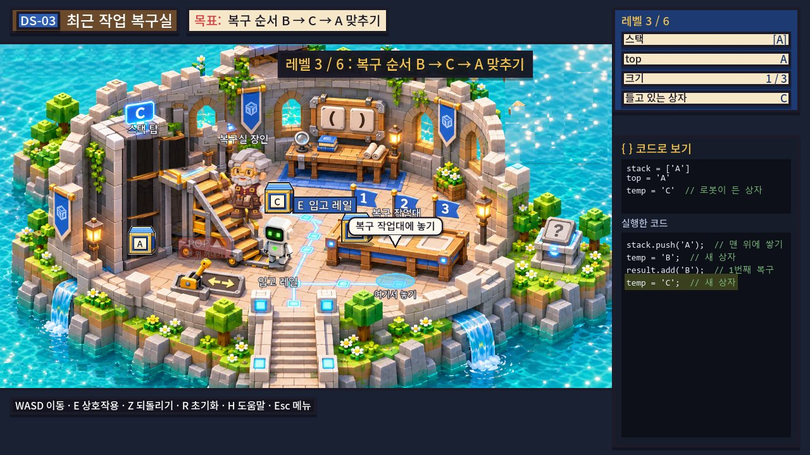
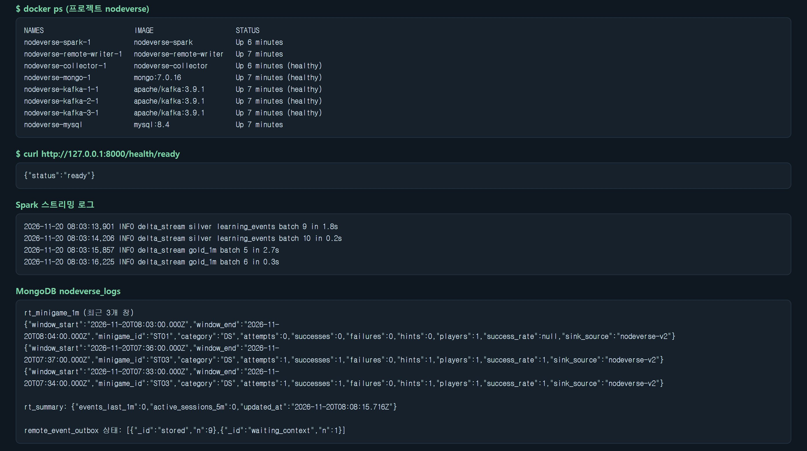
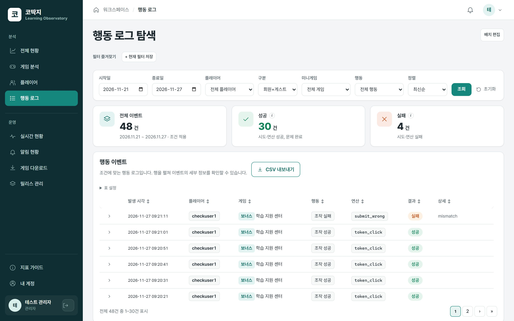
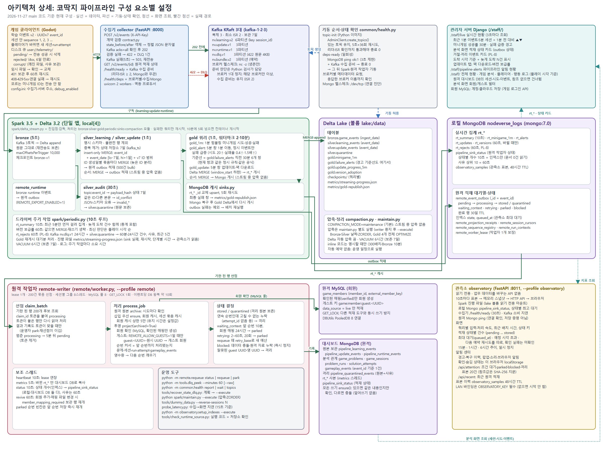
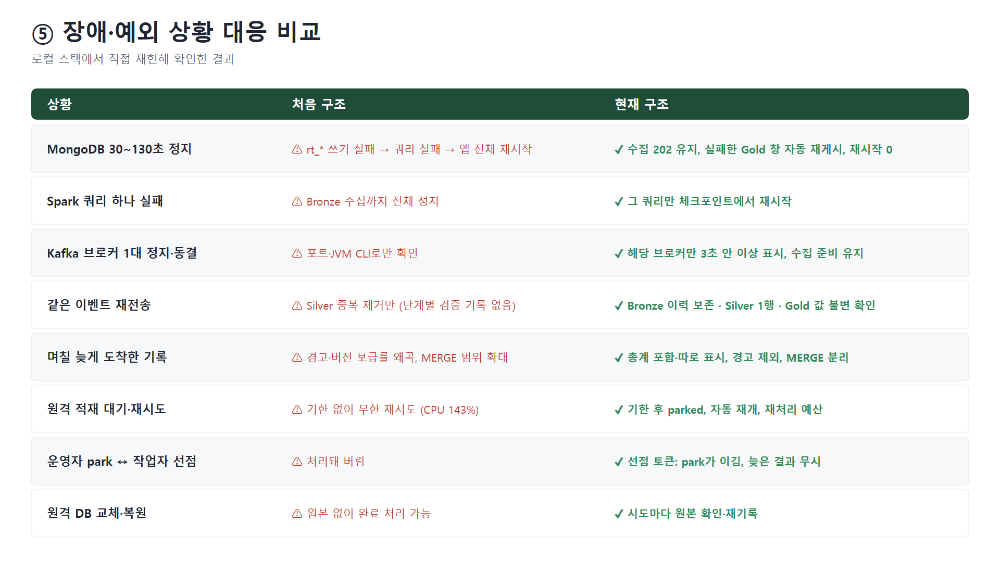
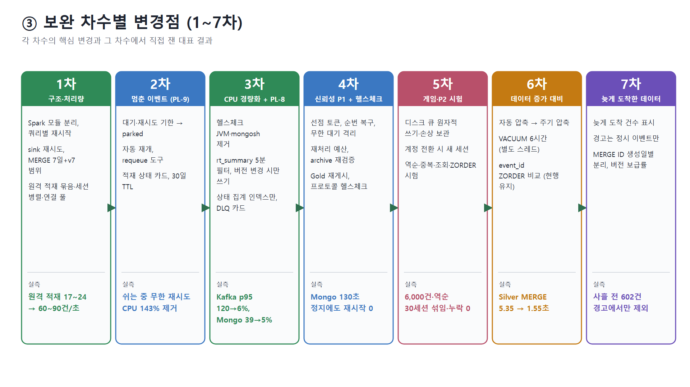
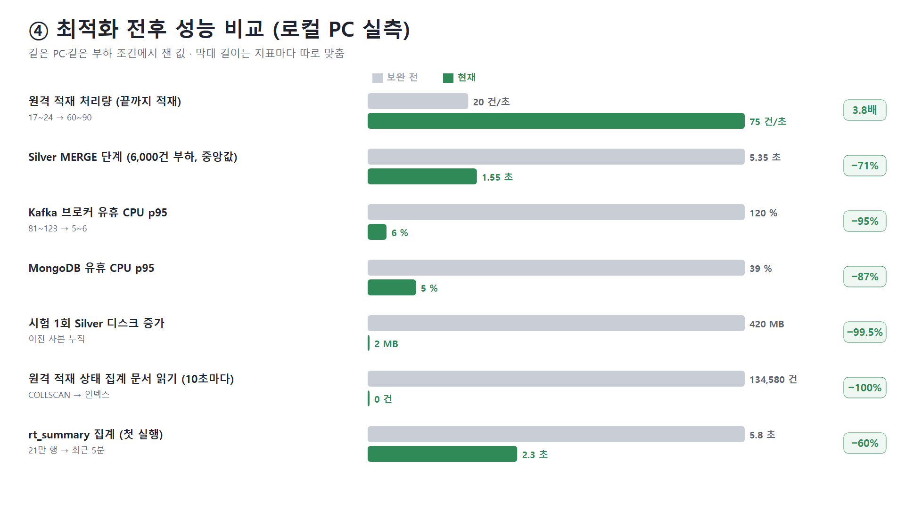

<div align="center">


# 코딱지

### 코딩을 딱 깨우치는 지름길

**게임을 하다 보면 자료구조·알고리즘·SQL이 손에 익고, 그 모든 플레이가 실시간 데이터 파이프라인을 타고 학습 진단이 됩니다.**


[**▶ itch.io에서 플레이**](https://kingdoms1212.itch.io/kkotackji) &nbsp;·&nbsp; [**📊 관리자 대시보드 둘러보기**](#3-3-서버-server) &nbsp;·&nbsp; [**🏗 아키텍처**](#4-종합-구조와-동작-흐름)


</div>

## 숫자로 보는 코딱지

| 🎮 미니게임 | 🏝 3D 월드 | ⚡ 실시간 처리 | ⏱ 대시보드 반영 |
|:---:|:---:|:---:|:---:|
| **24종**<br><sub>자료구조·알고리즘·SQL·데이터</sub> | **섬 7개**<br><sub>다리로 연결된 월드</sub> | **초당 200건**<br><sub>유입을 그대로 따라감</sub> | **평시 10~18초**<br><sub>게임 행동 → 관리자 화면</sub> |
| 🚀 **원격 적재 약 9배**<br><sub>초당 17~24건 → 219건</sub> | 🔁 **Silver MERGE 약 3.5배**<br><sub>5.35초 → 1.55초</sub> | 🪶 **쉬는 중 Kafka CPU**<br><sub>p95 81~123% → 5~6%</sub> | 🛡 **MongoDB 130초 정지**<br><sub>수집 계속 · Spark 재시작 0회</sub> |

<sub>모든 수치는 같은 로컬 PC(Windows 11 ARM64, WSL2 Docker, Spark 4코어)에서 직접 잰 값입니다. 운영 환경 수치가 아닙니다. 근거: [구조 비교와 최적화](docs/presentation/NODEVERSE_파이프라인_구조비교_최적화.md), [Silver MERGE·압축 보완](docs/changes/2026-11-21_silver_merge_scaling.md)</sub>

## 이 프로젝트가 특별한 이유

- 🛡 **장애에 강합니다.** 게임은 기록을 디스크 큐에 먼저 쓰고, 수집기는 Kafka 복제가 끝난 뒤에만 받았다고 답합니다. Spark가 멈춰도 Kafka 7일 보관과 쿼리별 체크포인트로 이어서 처리하고, 같은 기록이 여러 번 와도 한 번만 반영합니다. → [5-2. 장애 복구](#5-2-장애-복구)
- ⚡ **실시간입니다.** 수집 API → Kafka → Spark Structured Streaming + Delta Lake(Bronze·Silver·Gold) → MongoDB를 거쳐, 게임 속 행동이 십몇 초 안에 관리자 실시간 화면에 올라옵니다. 늦게 도착한 기록까지 따로 다룹니다. → [5-1. 지연 이벤트](#5-1-지연-이벤트-늦게-도착한-기록)
- 🧠 **학습을 진단합니다.** 게임별 해결률·오답률·재시작·다시 하기로 "어느 게임, 어느 조작에서 막히는지"를 데이터로 보여 줍니다. 되돌리기처럼 판정이 없는 조작은 오답률에서 뺍니다. → [학습 지표 정의](#3-3-서버-server)
- 🎮 **진짜 게임입니다.** Godot 3D 섬 월드와 미니게임, 회원가입·클라우드 세이브, 시작할 때 확인하는 자동 업데이트·리소스 팩까지 갖췄습니다. → [3-1. 게임](#3-1-게임-game)

## 한눈에 보기

| 3D 월드 로비 | 스택 스테이지 (DS-03) |
|:---:|:---:|
|  |  |
| **관리자 전체 현황** (재시작·다시 하기·오답률) | **실시간 현황** (성공률·실패 급증 경고) |
|  |  |

<sub>대시보드 화면은 로컬에서 합성 데모 데이터로 띄운 모습입니다.</sub>

---

## 빠른 시작

MLO 2기 3차 프로젝트 1팀 통합 저장소입니다. 서비스 이름은 **코딱지**이고, 이전 이름은 NODEVERSE입니다.
게임·관리자 대시보드·관측소·소개 페이지의 화면 표기는 코딱지입니다. 저장소·폴더·파일 이름과 코드 식별자(`nodeverse.code-workspace`, `NodeverseWorld.tscn`, `nodeverse_logs`, 내보내기 파일 `NODEVERSE.exe` 등)에는 이전 이름이 남아 있습니다.

```bash
git lfs install        # game/ 의 Godot 에셋은 LFS로 받습니다
git clone https://github.com/encore-ai-campus/mlo-02-p3-team1.git
code mlo-02-p3-team1/nodeverse.code-workspace
```

> 처음 받는 사람은 [개발환경 구성 가이드](docs/SETUP_GUIDE.md)부터 보세요. 한 PC에서 전체를 띄우려면 저장소 루트의 **`전체실행.cmd`** 를 더블클릭하세요(중지: `전체중지.cmd`, 상태: `상태확인.cmd`, DB 조회: `DB조회화면.cmd`·`DB조회_몽고.cmd`·`DB조회_MySQL.cmd`, 자세히: [LOCAL_RUN_WINDOWS_ARM.md](docs/LOCAL_RUN_WINDOWS_ARM.md)).

---

## 1. 개요

코딱지는 **자료구조·알고리즘·SQL·데이터 탐색**을 3D 섬 월드와 2D 미니게임으로 배우는 교육용 게임 플랫폼입니다.
플레이어가 게임에서 하는 학습 행동(문제 시작, 조작 성공·실패, 힌트, 시도 결과)을 이벤트로 수집하고,
실시간 파이프라인에서 검증·집계해 관리자 대시보드에서 게임별 학습 현황과 어려운 게임을 확인합니다.

| 구성 | 한 줄 설명 |
|---|---|
| 게임 | Godot 4.7 클라이언트. 섬 7개로 된 3D 월드와 미니게임(실습 23종 + 보너스, 종합 도전 2종), 학습 이벤트 송신, 회원·클라우드 세이브, 자동 업데이트 |
| 파이프라인 | 수집 API → Kafka → Spark Structured Streaming + Delta Lake(Bronze·Silver·Gold) → MongoDB, 원격 DB 적재, 읽기 전용 관측소 |
| 서버 | Django 관리자 대시보드, 게임 회원·세이브 API, 배포·업데이트 관리, 소개 웹사이트 |

**팀**

| 이름 | 역할 |
|---|---|
| 유성원 (팀장) | 서버·대시보드, MySQL 저장·조회 |
| 서정길 | 총괄·검토 |
| 박준범 | 게임 |
| 이어진 | 파이프라인: 수집·전달·정제·집계·MongoDB 저장 |

---

## 2. 저장소 구성

게임·파이프라인·서버를 폴더별로 나눈 모노레포입니다.

각 경로의 README에 해당 파트의 실행 방법과 상세 설명이 있습니다.

| 경로 | 내용 | 설명서 |
|---|---|---|
| `game/` | Godot 게임 클라이언트, 소개 웹사이트 원본 | [game/README.md](game/README.md) |
| `pipeline/` | 수집기·Kafka·Spark/Delta·원격 적재 작업자·관측소 | [pipeline/README.md](pipeline/README.md) |
| `server/` | Django 대시보드·게임 API | [server/README.md](server/README.md) |
| `contracts/` | 세 파트 공통 이벤트 형식·Kafka 토픽 | [contracts/README.md](contracts/README.md) |
| `docs/` | 팀 공통 문서·보고서·아키텍처 그림 | [docs/README.md](docs/README.md) |

```
mlo-02-p3-team1/
├─ game/        Godot 프로젝트 (바이너리 에셋은 Git LFS)
├─ pipeline/    collector.py · spark/ · remote/ · observatory/ · compose.json · launcher.py
├─ server/      config/ · accounts/ · telemetry/ · templates/ · static/
├─ contracts/   공통 이벤트 규약
├─ docs/        가이드 · 검토 · 보고서 · architecture/
├─ .github/workflows/   폴더별 CI (pipeline·server·game)
└─ nodeverse.code-workspace
```

- 작업 브랜치는 `game/…`, `pipeline/…`, `server/…`, `contracts/…`, `docs/…` 접두어를 쓰고 PR로 `main`에 합칩니다. `contracts/`를 바꾸는 PR은 세 파트 모두 리뷰합니다.
- `.env`·API 키는 절대 커밋하지 않습니다. `.env.example`만 올립니다.

---

## 3. 파트별 개요와 동작 방식

### 3-1. 게임 (`game/`)

<details>
<summary><b>게임 구성과 동작 방식 펼쳐 보기</b></summary>


| 항목 | 내용 |
|---|---|
| 엔진 | Godot **4.7.2** (웹 빌드는 Compatibility/WebGL2) |
| 메인 씬 | `scenes/NodeverseWorld.tscn` — 메인 섬과 자료구조·알고리즘·SQL·데이터 섬이 다리로 연결된 3D 월드 |
| 미니게임 | `scripts/learning_catalog.gd`: 실습 23종(DS 9 · ALGO 6 · SQL 4 · DATA 4) + 자료구조 종합 보너스, 종합 도전 섬의 판테온 코드 자동화·종합 코딩테스트 |
| 자동 로드 | `NetworkManager`(이벤트 송신·회원 API·F6 디버그 패널), `UpdateManager`(시작 시 업데이트 확인) |
| 주소 설정 | `config.ini`(예시 `game/config.ini.example`)의 `[pipeline]`·`[server]` 주소와 `[debug] debug_enabled`. EXE 옆 또는 `project.godot` 옆에 두고 재시작 |
| 내보내기 | `Windows Desktop`(EXE), `Web`, `Content Pack`(.pck 리소스 팩) |

**동작 방식**
1. 로그인하면 Django `/api/game/auth/login`으로 회원을 확인하고 클라우드 세이브를 불러옵니다. 이후 학습 이벤트의 `player_id`는 회원 ID입니다.
2. 미니게임에서 행동이 일어날 때마다 `NetworkManager`가 v2 이벤트를 만들어 **디스크 큐**(`user://telemetry/pending/`)에 먼저 저장합니다.
3. 큐에서 하나씩 `POST /v2/events`로 보냅니다(3초 타임아웃, `X-API-Key`). 202면 삭제, 4xx 거절은 `rejected/`로 옮기고(401 키 오류는 큐에 둔 채 60초마다 재시도), 그 밖의 오류는 같은 event_id로 1~60초 간격으로 재시도합니다. 네트워크가 없어도 게임은 멈추지 않습니다.
4. 시작할 때 `/api/game/manifest`로 새 버전·리소스 팩을 확인하고 업데이트 이벤트를 보냅니다.
5. 실행·종료 감시는 `launcher.exe`(`pipeline/launcher.py`)가 맡아 `/v1/events`로 보냅니다.
6. 한 번의 미니게임 플레이가 실행(run) 하나입니다. 레벨을 시작할 때마다 시도(attempt)를 열고, 조작한 뒤 R(다시 시작)을 누르면 그 시도를 실패로 닫고 같은 레벨의 새 시도를 엽니다(아무 조작이 없으면 보내지 않음). 게임을 완료한 뒤의 "다시 하기"는 레벨 1부터 새 실행으로 시작합니다.
7. 수집기·Django 주소는 `config.ini`가 있으면 그 값을, 없으면 기존 JSON 설정이나 코드 기본값을 씁니다. 디버그 기능(F3~F6)은 `debug_enabled`로 켜고 끕니다.

**실행 화면**

| 로비 | 스테이지 자동 풀이 (DS-03 스택) |
|---|---|
|  |  |

자세히: [`game/README.md`](game/README.md), [`game/MINIGAME_GUIDE.md`](game/MINIGAME_GUIDE.md), [`game/docs/`](game/docs/)

</details>

### 3-2. 파이프라인 (`pipeline/`)

<details>
<summary><b>파이프라인 구성과 보장 펼쳐 보기</b></summary>


대용량 누적 기록에 대비한 **선택 압축·코드 사전 확장 설계**를 문서로 보관합니다. 기존 실시간 JSON 전송은 유지하며, 관련 참조 구현을 전체 게임·운영에 적용한 상태는 아닙니다. 실제 데이터 규모가 커졌을 때 크기·CPU·지연을 비교한 뒤 적용 여부를 결정합니다. 자세히: [압축·사전 확장 설계](pipeline/docs/COMPRESSION_EXTENSION.md).

| 구성 요소 | 역할 |
|---|---|
| `collector.py` (FastAPI) | `POST /v2/events` 단일 이벤트 수집. 키 확인 → 스키마 검사 → 토픽 분류 → Kafka `acks=all` 확인 후 **202**. 잘못된 입력은 **422 + DLQ**, Kafka 장애는 **503** |
| Kafka 3대 | 토픽 5개, 복제 3·최소 ISR 2, 보관 7일 |
| `spark/` | Spark 앱 1개·스트리밍 쿼리 7개(원격 적재 시 8개). `delta_stream.py`가 진입점·감독이고 `bronze`·`silver`·`gold`·`periodic`·`sinks`·`compaction` 모듈이 Bronze(원본 보존) → Silver(검증·중복 제거) → Gold(1분·5분 집계) → MongoDB `rt_*`를 처리 |
| `remote/` (remote-writer) | Silver를 통과한 이벤트를 outbox에 쌓고, 작업자가 원격 MySQL·MongoDB에 서버가 읽는 형태(세션·문제 실행·시도·이벤트)로 적재 |
| `observatory/` | 읽기 전용 관측소(:8011). 쿼리별 처리 속도, 적재 상태별 건수·최대 대기, 경고·복구 이력과 알림 센터 |
| `simulator.py`, `spark/verify.py`, `spark/probe_latency.py` | 계약 점검·부하 시험·행 수 대조·지연 측정 |
| `launcher.py` | 게임 실행기. 실행·하트비트·종료 이벤트를 SQLite 큐에 보관 후 전송 |

**동작 방식과 보장**
- **유실 방지:** 202는 Kafka에 복제·기록된 뒤에만 돌려줍니다. Kafka가 7일 보관하므로 Spark가 멈춰도 재시작하면 체크포인트부터 이어서 처리합니다.
- **중복 방지:** 같은 event_id 재전송은 Silver에서 7일 동안 걸러지고, insert-only MERGE라 다시 실행해도 행이 늘지 않습니다. 같은 ID에 다른 내용이 오면 `silver.quarantine`에 `id_conflict`로 격리합니다.
- **지연:** 이벤트가 대시보드 `rt_*`에 반영되기까지 평시 약 10~18초입니다(구조상 제약, D22).
- **원격 적재:** 회원 매핑이 없거나 세션 순서가 비면 `waiting_context`로 기다리고, 잘못된 데이터는 `blocked`, 일시 오류는 `retrying`으로 둡니다. `REMOTE_ALLOW_GUESTS=1`이면 등록 회원에 없는 UUID 플레이어를 게스트 회원으로 적재합니다.
- **압축:** 각 테이블을 쓰는 스레드가 300배치마다 작은 파일만 합치고, Silver는 outbox 적재 뒤·Gold는 MongoDB 게시 뒤에 압축해 원격 적재와 화면 게시가 기다리지 않습니다.
- **상태 객체:** 게임이 `state_before`·`state_after`를 객체로 보내면 수집기가 정렬된 JSON 문자열로 바꿔 받습니다.

**실행 화면**



자세히: [`pipeline/README.md`](pipeline/README.md), [`pipeline/docs/DECISIONS.md`](pipeline/docs/DECISIONS.md), [`pipeline/docs/LIVE_REMOTE_SINK.md`](pipeline/docs/LIVE_REMOTE_SINK.md)

</details>

### 3-3. 서버 (`server/`)

<details>
<summary><b>서버 구성·학습 지표 정의·실시간 현황 펼쳐 보기</b></summary>


| 항목 | 내용 |
|---|---|
| 프레임워크 | Django 5.2, MySQL(회원·관리자·배포) + MongoDB(플레이 기록·실시간 지표) |
| 앱 | `accounts`(관리자 가입·로그인), `telemetry`(분석 화면·게임 API·배포) |
| 관리자 화면 | `/staff/` 개요, `/staff/games/` 게임별, `/staff/players/` 회원별, `/staff/members/` 게임 회원·세이브, `/staff/events/` 행동 로그, `/staff/guide/` 지표 안내, `/staff/live/`(3초 갱신 실시간), `/staff/pipeline-alerts/`, `/staff/releases/` |
| 게임 공개 API | `POST /api/game/auth/{register,login,find-id,reset-password,save}`, `GET /api/game/manifest` |
| 서버 간 API | `POST /api/game/records`, `/api/game/player-login` (`GAME_SERVER_API_KEY`) |

**동작 방식:** 서버는 학습 이벤트를 직접 받지 않습니다. 실시간 화면은 파이프라인이 채운 `rt_*`를 읽고, 분석 화면은 remote-writer가 적재한 `game_sessions`·`problem_runs`·`solution_attempts`·`gameplay_events`·`pipeline_learning_events`를 읽습니다. 게임이 서버를 직접 부르는 것은 회원가입·로그인·세이브·업데이트 확인뿐입니다.

**학습 지표 정의** (분석 화면, [`server/telemetry/learning.py`](server/telemetry/learning.py))

지표는 **미니게임 하나(실행 ID)** 단위로, 그 게임의 레벨 1·2·3을 합쳐 계산합니다. 게임 분석의 게임 카드는 콘텐츠 버전도 합치고, 문제·버전별 어려움 표와 개요의 주의 목록은 버전별로 나눕니다(같은 게임이라도 버전이 다르면 합치지 않음). 한 번의 **실행**은 게임에 들어가서 나올 때까지이고, 레벨 1회 도전이 **시도**, 그 안의 행동 하나가 **조작**입니다. 레벨별 지표 화면은 없습니다.

| 지표 | 계산 방식 |
|---|---|
| 해결률 | 완료한 실행 ÷ 시작한 실행. 선택 기간에 시작한 실행을 현재 결과까지 추적합니다 |
| 재시작 | 게임을 완료하기 전에, 실패했거나 끝내지 않은 레벨을 다시 시작한 실행 수(한 실행에서 여러 번이어도 1건). 이미 깬 레벨을 다시 해 보는 연습, 다음 레벨 진입, 아무 조작 없이 누른 R은 세지 않습니다 |
| 다시 하기 | 이미 완료한 게임(별 개수 무관)을 다시 푼 실행 수. 같은 플레이어가 이전 실행에서 완료한 경우(선택 기간 이전 완료 포함)와, 예전 빌드처럼 같은 실행에서 완료 뒤 계속 플레이한 경우를 셉니다 |
| 오답률 | 잘못된 조작 ÷ 판정된 조작(`operation_failed` ÷ `operation_succeeded`+`operation_failed`). 다시 시작(R)은 조작이 아니라 새 시도라 들어가지 않고, 맞고 틀림을 판정하지 않는 되돌리기(`undo`)와 코딩테스트 토큰 입력(`token_click`)도 뺍니다. 판정된 조작이 없으면 —로 표시합니다 |
| 힌트 뒤 성공 | 첫 힌트를 쓴 시도(레벨)가 성공으로 끝난 비율. 관찰 결과이며 힌트의 효과를 뜻하지 않습니다 |

- 개요 화면의 주의 목록은 **재시작률**(재시작 실행 ÷ 문제 실행)이 높은 게임 순이고, 같으면 실행 수가 많은 순입니다. 문제·버전별 어려움 표는 포기율 순입니다.
- 분야별(자료구조·알고리즘·SQL·데이터 탐색) 화면은 지금은 해결률만 보여 줍니다. 분야별 오답률 등은 추후 통합 현황 화면에서 다룹니다.
- ST10은 통합 퀴즈·최종 도전·코딩테스트 세 게임이 한 실행 ID를 함께 씁니다. 코딩테스트 실행은 판정된 조작이 제출 실패뿐이라 오답률에서 뺍니다.
- 플레이어 목록의 **연산 성공률**은 조작 성공 ÷ 조작으로, 회원 비교용입니다(되돌리기 등도 포함).

**실시간 현황 (`/staff/live/`)**

- 파이프라인이 MongoDB `rt_*`에 쓴 집계를 3초마다 다시 읽습니다. 최근 1분 이벤트 수, 5분 활성 세션, 최근 30분 시도 수, 게임별 **성공률(시도 기준)** 추이, 분야별 시도 수, 실패 급증 경고를 보여 줍니다.
- 여기서의 성공·실패는 레벨 도전(시도) 기준입니다. 완료 전 다시 시작(R)과 목숨 소진도 실패에 들어가므로, 조작 기준인 오답률과 다른 값입니다.
- **실패 급증 경고**([`pipeline/spark/gold.py`](pipeline/spark/gold.py)): 1분씩 밀리는 5분 창마다 게임별로 시도 20회 이상, **실패율(시도 기준)** 0.4 이상, 직전 30분 평소 실패율의 1.5배 이상이면 경고로 기록합니다. 받은 시각이 플레이 시각보다 5분 넘게 늦은 기록은 경고 판정에서만 빼고, 1분 집계에는 받은 시각 기준으로 넣습니다. 2~5분 늦은 기록은 집계 창(워터마크 2분)이 이미 닫혀 실시간 집계에서 빠질 수 있으며, 분석 화면에는 반영됩니다. 경고는 실시간 화면의 최근 60분 표에만 나오며, 슬랙·메일 같은 외부 알림은 없습니다.
- 파이프라인 관측소(:8011)의 브라우저 알림은 학습 지표가 아니라 파이프라인 장애(스트리밍 쿼리 중단, 처리·배치 지연, 적재 중단·대기 등)를 알리는 용도입니다.

**실행 화면**

| 전체 현황 | 실시간 현황 | 행동 로그 |
|---|---|---|
|  |  |  |

자세히: [`server/README.md`](server/README.md), [`server/docs/`](server/docs/)

</details>

### 3-4. 데이터 규약 (공통)

<details>
<summary><b>이벤트 규약 펼쳐 보기</b></summary>


기준은 [`pipeline/contract.py`](pipeline/contract.py)이고 사본이 [`contracts/`](contracts/)에 있습니다. 게임과 파이프라인은 이 규약과 일치합니다.

| 종류 | 토픽 · 파티션 키 | 이벤트 |
|---|---|---|
| 학습 v2 | `nv.learning.v2` · session_id | problem_started, attempt_started, operation_succeeded, operation_failed, hint_used, attempt_succeeded, attempt_failed, problem_completed |
| 업데이트 v2 | `nv.update.v1` · player_id | update_checked·prompted·accepted·dismissed, pack_download_started·succeeded·failed, pack_mounted, build_changed |
| 실행 v1 | `nv.runtime.v1` · run_id | run_started, run_heartbeat, exit_* (근거 evidence 필수) |
| 거부 | `nv.dlq.v1` | 422로 거절된 원문(4KB까지)과 사유 |

학습 이벤트 예시:

```json
{
  "schema_version": 2,
  "event_id": "UUID", "player_id": "회원 ID 또는 설치 ID",
  "session_id": "UUID", "run_id": "UUID", "attempt_id": "UUID (선택)",
  "minigame_id": "ST03", "category": "DS",
  "build_version": "0.3.0", "content_version": "base",
  "event_type": "operation_failed",
  "occurred_at": "2026-11-20T03:40:12.345Z",
  "sequence": 7,
  "details": { "operation": "pop", "failure_reason": "empty_stack", "mistakes": 1 }
}
```

- `occurred_at`은 UTC 밀리초 형식입니다. 5분 넘게 미래면 거절, 6일 넘게 지났으면 `too_old`로 거절합니다.
- `details`에는 허용된 키만(operation, failure_reason, level, moves, mistakes, stars, hint_id, state_before, state_after) 2KB 이하로 넣습니다.
- `minigame_id`와 `category` 조합이 카탈로그와 다르면 거절합니다.
- `sequence`는 세션 안에서 1부터 빠짐없이 증가해야 원격 적재가 진행됩니다.

</details>

---

## 4. 종합 구조와 동작 흐름

<details>
<summary><b>전체 흐름도와 PC별 구성 펼쳐 보기</b></summary>




원본 SVG: [`docs/architecture/pipeline-architecture-2026-11-25.svg`](docs/architecture/pipeline-architecture-2026-11-25.svg) (생성: `python docs/architecture/pipeline_architecture.py`). 한 장짜리 개요는 [`pipeline/docs/architecture.png`](pipeline/docs/architecture.png)입니다. 보완 전 흐름과 문제 지점은 아래 그림입니다.


원본 SVG: [`docs/architecture/data-flow-2026-11-20.svg`](docs/architecture/data-flow-2026-11-20.svg). 그림의 BN·PL·GM·CM 번호는 [데이터 흐름과 보완 목록](docs/DATA_FLOW_AND_GAPS.md)의 항목입니다.

| 순서 | 위치 | 일어나는 일 |
|---|---|---|
| ① | 게임 PC | 학습 행동 → 이벤트 생성 → 디스크 큐 → `POST /v2/events` |
| ② | 파이프라인 PC (.81) | 게이트웨이 :8000 → 수집기가 검사 후 Kafka에 기록, 202 응답 |
| ③ | 〃 | Spark Bronze(원본) → Silver(검증·중복 제거) → Gold(1분·5분 집계) |
| ④ | 〃 | Gold → 로컬 MongoDB `rt_*`, Silver → outbox |
| ⑤ | 〃 → DB PC (.167) | remote-writer가 MySQL `game_members`, MongoDB 세션·시도·이벤트와 `rt_*` 사본으로 적재 |
| ⑥ | 대시보드 PC (.29) | Django가 MySQL·MongoDB를 읽어 `/staff/` 화면에 표시 |
| ⑦ | 파이프라인 PC | 관측소(:8011)가 Spark 진행 파일·로컬 MongoDB를 읽어 처리 상태와 경고 표시 |
| ⑧ | 게임 ↔ Django | 회원가입·로그인·클라우드 세이브·업데이트 확인은 직접 호출 |

| PC | 실행하는 것 | 기본 포트 |
|---|---|---|
| 게임 PC | 게임 EXE, launcher.exe | — |
| 파이프라인 PC | 게이트웨이, 수집기, Kafka×3, Spark, 로컬 MongoDB, remote-writer, 관측소 (Docker Compose) | 8000(게이트웨이), 8003(수집기), 27017·27020(Mongo), 8011(관측소) |
| DB PC | MySQL, MongoDB | 3306, 27017 |
| 대시보드 PC | Django | 8000 |

한 PC 로컬 실행(`전체실행.cmd`)에서는 게이트웨이 없이 수집기가 `127.0.0.1:8000`(`/v2/events`), Django가 `127.0.0.1:8010`(`/staff/login/`), MySQL이 `127.0.0.1:3306`, MongoDB가 `127.0.0.1:27017`, 관측소가 `127.0.0.1:8011`을 씁니다.

</details>

---

## 5. 지연 이벤트 · 장애 복구 · Delta 튜닝

### 5-1. 지연 이벤트 (늦게 도착한 기록)

<details>
<summary><b>지연 이벤트 처리 펼쳐 보기</b></summary>


오프라인 큐, 수집 서버 장애 복구, 업데이트 대기 때문에 며칠 전 플레이 기록이 오늘 처음 도착할 수 있습니다. 원칙은 **저장은 버리지 않고, 실시간 화면은 도착 시각, 분석 화면은 플레이 시각**입니다.

| 항목 | 처리 |
|---|---|
| 정의 | 플레이 시각(`occurred_at`, 기기 시계)과 받은 시각(`received_at`, 수집기 시계)이 300초 넘게 차이 나면 늦은 이벤트입니다 ([`pipeline/common/lateness.py`](pipeline/common/lateness.py)). 수집기는 6일 넘게 지난 기록을 `too_old`로 거절하고, 게임도 6일 지난 기록은 큐에서 만료합니다 |
| Silver 시간 | 늦은 이벤트는 `event_time`을 받은 시각으로 바꿔 저장합니다. 원래 `occurred_at`은 그대로 남습니다 |
| 실시간 화면 (Gold, `rt_*`) | 1분 집계에 받은 시각 기준으로 들어갑니다. 상단 지표에 "늦게 도착 N건 포함"으로 따로 표시합니다 |
| 실패 급증 경고 | 정시 이벤트만으로 판정합니다. 장애 복구 직후 한꺼번에 들어온 옛 실패가 거짓 경고를 만들지 않습니다 |
| 분석 화면 | 원격 적재가 세션·시도·이벤트에 플레이 시각을 그대로 넣으므로, 날짜별 학습 통계는 실제 플레이 날짜로 셉니다 |
| Silver MERGE | 늦은 ID가 섞인 배치는 ID 생성일별로 나눠 MERGE해 스캔 범위가 넓어지지 않습니다 |
| 버전 보급률 | 플레이어별 최신 버전을 플레이 시각 순으로 판단해, 늦게 온 옛 버전 기록이 다운그레이드처럼 보이지 않습니다 |

- 1분 집계·경고 집계의 워터마크는 2분입니다. 300초 이내라 플레이 시각을 그대로 쓰는 기록 중 2~5분 늦게 도착한 것은 이미 닫힌 창에 해당해 실시간 집계에서 빠질 수 있습니다. 분석 화면에는 반영됩니다.
- 로컬 시험에서 사흘 전 기록 602건을 현재 트래픽 2,005건과 함께 보냈을 때, 602건 모두 저장·총계에 포함되고 경고 판정에서만 빠졌습니다(경고 창 시도 수 차이 84건 = 늦은 기록의 시도 수). 자세히: [늦게 도착한 데이터 처리](docs/changes/2026-11-21_late_events.md)
- 30일 넘게 오프라인으로 쌓인 기록을 별도 경로(`/v2/offline`, 90일 이내)로 올리는 장기 동기화는 구현·격리 시험까지 했고 운영에서는 꺼져 있습니다. 자세히: [장기 오프라인 동기화](pipeline/docs/OFFLINE_SYNC_2026-11-25.md)

</details>

### 5-2. 장애 복구

<details>
<summary><b>장애 지점별 대응 펼쳐 보기</b></summary>


어느 한 단계가 멈춰도 앞 단계가 기록을 보관하고, 다시 살아나면 같은 ID로 이어서 처리합니다. 재전송은 여러 번 일어날 수 있지만 event_id·내용 해시·insert-only MERGE로 결과가 한 번만 반영되게 만듭니다(분산 트랜잭션 기반 exactly-once를 보장한다는 뜻은 아닙니다).

| 장애 지점 | 대응 |
|---|---|
| 게임 PC 네트워크 끊김·강제 종료 | 이벤트를 먼저 디스크 큐(`user://telemetry/pending/`)에 쓰고 202를 받은 뒤에만 지웁니다. 끊기거나 종료돼도 다음 실행 때 같은 event_id로 다시 보냅니다(1~60초 간격 재시도, 최대 5,000건). 4xx는 그 건만 `rejected/`로 옮기고, 401은 보관한 채 재시도합니다 |
| 수집기 · Kafka | Kafka `acks=all` 확인 뒤에만 202를 줍니다. Kafka가 응답하지 않으면 5초 안에 503을 돌려주고 게임이 다시 보냅니다. 복제 3·최소 ISR 2라 브로커 1대가 멈춰도 수집은 계속됩니다 |
| Spark | 쿼리마다 체크포인트가 있고 Kafka가 7일 보관하므로, Spark가 멈췄다 다시 뜨면 마지막 처리 위치부터 이어 갑니다. 감독 루프가 실패한 쿼리만 체크포인트에서 다시 시작하고, 10분 안에 5회를 넘으면 컨테이너를 재시작합니다 |
| 중복 | 같은 event_id 재전송은 Silver 상태 저장소(기본 7일)와 insert-only MERGE로 걸러져 행이 늘지 않습니다. 같은 ID에 다른 내용이 오면 `silver.quarantine`에 격리합니다 |
| 로컬 MongoDB (`rt_*`) | 쓰기를 5회 재시도하고, 끝내 실패한 창은 기록해 두었다가 Gold Delta에서 다시 게시합니다. 로컬 시험에서 MongoDB를 130초 멈춰도 수집은 계속됐고 Spark 재시작은 0회였습니다 |
| 원격 적재 (outbox → 원격 MySQL·MongoDB) | 상태(pending·processing·stored·retrying·waiting_context·parked·blocked·quarantined)를 outbox에 남깁니다. 일시 오류는 `retrying`, 기한·횟수를 넘으면 `parked`로 두고 조건이 맞으면 자동 재개합니다. 세션 순번 순서를 지키며 다른 세션은 막지 않습니다 |
| 거절된 기록 (DLQ) | 422 원문을 `nv.dlq.v1`에 남깁니다. 계약 호환 문제로 거절된 기록은 [`pipeline/tools/recover_state_dlq.py`](pipeline/tools/recover_state_dlq.py)로 계획을 만든 뒤 같은 ID로 다시 보낼 수 있습니다(2026-11-25에 45건 복구, 기존 기록 변경 0건) |
| 확인 | 관측소(:8011)가 쿼리 중단, 처리·배치 지연, 적재 대기·중단을 표시하고 경고·복구 이력을 남깁니다 |



자세히: [게스트 처리·이벤트 복구 보고](pipeline/docs/RECOVERY_2026-11-25.md), [신뢰성 보완 기록](docs/changes/2026-11-20_pipeline_reliability.md), [구조 비교 자료](docs/presentation/NODEVERSE_파이프라인_구조비교_최적화.md)

</details>

### 5-3. Delta 튜닝 비교

<details>
<summary><b>Delta 튜닝 전후 비교 펼쳐 보기</b></summary>


Bronze는 원본을 append만 하고, Silver는 중복 제거 후 insert-only MERGE, Gold는 1분·5분 창 집계를 MERGE로 씁니다. 데이터가 늘어도 매 배치가 필요한 범위만 읽고 쓰도록 아래처럼 바꿨습니다.

| 항목 | 이전 | 현재 |
|---|---|---|
| Silver MERGE 조건 | `event_id` 하나 → 배치마다 Silver 전체 스캔 | 배치 날짜 −7일~+1일 범위와 UUIDv7 ID 범위를 조건에 추가, ID 생성일별로 나눠 MERGE |
| 파일 압축 | Delta 자동 압축이 커밋마다 날짜 파티션 전체를 다시 씀(실데이터 약 30MB인 Silver가 디스크 4.9GB, Bronze 7.5GB) | 자동 압축 끔. 쓰기 스레드가 300배치마다 작은 파일만 압축(64~128MB 목표), Bronze는 10분마다, outbox 적재·MongoDB 게시가 끝난 뒤 실행 |
| VACUUM | — | 별도 스레드에서 6시간마다 (실시간 요약 갱신을 막지 않음) |
| ZORDER | — | `ZORDER BY (minigame_id, player_id, event_id)` 유지. `event_id` 단독 ZORDER와 비교한 결과 MERGE는 비슷하고(1.08~1.83초 대 1.16~1.86초) 플레이어 1명 조회는 단독 쪽이 2.4~2.6배 더 읽어 현행 유지 |

같은 부하(6,000건, 초당 100건)에서 비교한 결과입니다.

| 지표 | 이전 | 현재 |
|---|---|---|
| Silver MERGE 단계 중앙값 | 5.35초 | 1.55초 |
| Silver learning 배치 중앙값 | 5.65초 | 1.75초 |
| gold_1m 배치 중앙값 | 3.60초 | 2.20초 |
| 시험 1회 디스크 증가 (Silver / Bronze) | +420MB / +633MB | +2MB / +2MB |
| 원격 적재 완료 (전송 시작부터) | 104초 | 81초 |





모든 수치는 같은 로컬 PC(Windows 11 ARM64, WSL2 Docker, Spark 4코어)에서 잰 값이며 운영 환경 수치는 아닙니다. 자세히: [Silver MERGE·압축 보완](docs/changes/2026-11-21_silver_merge_scaling.md), [구조 비교와 최적화](docs/presentation/NODEVERSE_파이프라인_구조비교_최적화.md)

</details>

---

## 6. 추후 예정

남은 항목만 적었습니다. 처리한 내용은 [변경 리포트](docs/reports/2026-11-20_NODEVERSE_변경리포트.md), [구조 비교 자료](docs/presentation/), [파이프라인 문서](pipeline/docs/)에, 항목별 근거(파일·줄 번호)는 [docs/DATA_FLOW_AND_GAPS.md](docs/DATA_FLOW_AND_GAPS.md)에 있습니다.

**파이프라인**
- 압축을 같은 배치 밖의 별도 작업으로 분리하고 테이블별 충돌 제어 (게시 지연·다음 배치 지연을 나눠 측정한 뒤)
- 원격 작업자 다중 프로세스: 지금 초당 약 200건까지 따라감. 그 이상이 계속되면 세션 단위로 나눠 확장
- 대량 부하 시험, 중복 제거 상태 48시간 비교, Silver MERGE 범위 최적화
- DLQ 재처리 범위 확대 (현재 복구 도구는 상태 객체 사례만)

**운영·보안**
- 게이트웨이(:8000 → v2 수집기) 설정을 저장소로 가져오기. 지금은 저장소만으로 운영 경로를 재현할 수 없음 (PL-1)
- Groq 키 폐기, 코봇 채팅을 서버 경유로 변경. 공용 저장소 기록에서는 키를 지웠음 (CM-1, CM-2)
- 수집기 동시 처리 제한 (PL-3의 남은 부분)
- 모든 PC 시간 동기화(NTP) 확인 (CM-4)

**게임**
- 최초 실행 시 guest UUID를 프로필에 보관하고 플레이마다 새 session UUID 만들기
- 남은 격리 원인 수정: 문제 시작 없이 온 행동 이벤트, `operation` 값 누락
- 최신 EXE로 실제 종단 시험(강제 종료·재실행·계정 전환·회원/게스트 포함), 실제 디스크 부족 재현

**구조 정리**
- Spark 처리 로직 단위 테스트, 흩어진 시험 스크립트 정리 (RF-9, RF-10)
- `contracts/`를 단일 기준으로 만들고 서버의 옛 스키마 정리 (CM-5, SV-3)
- 서버·게임 CI를 실제 테스트로 확장 (SV-4)
- `game/website`와 `server/website` 중복 정리
- 파이프라인 진행 현황판(실시간 현황의 파이프라인 탭): 요청 검토 완료, 보류

---

## 문서 모음

| 문서 | 내용 |
|---|---|
| [docs/HANDOFF_2026-11-23.md](docs/HANDOFF_2026-11-23.md) | 공용 저장소 인계 정리: 파트별 바뀐 것·읽을 문서·남은 일 |
| [docs/SETUP_GUIDE.md](docs/SETUP_GUIDE.md) | clone 후 파트별 개발환경 다시 구성하기 |
| [docs/DATA_FLOW_AND_GAPS.md](docs/DATA_FLOW_AND_GAPS.md) | 데이터 흐름, 병목, 보완·추가 구현 목록 |
| [docs/INTEGRATION_REVIEW_2026-11-20.md](docs/INTEGRATION_REVIEW_2026-11-20.md) | 세 파트 연동 검토 |
| [docs/reports/](docs/reports/) | 중간보고서, 델타레이크 오류수정내역, 로그인·클라우드세이브 정리 |
| [docs/presentation/](docs/presentation/) | 파이프라인 처음 구조·현재 구조·최적화(1~8차) 비교 PDF와 발표용 그림 6장 (16:9 PNG·SVG) |
| [contracts/README.md](contracts/README.md) | 공통 이벤트 규약과 남은 차이 |
