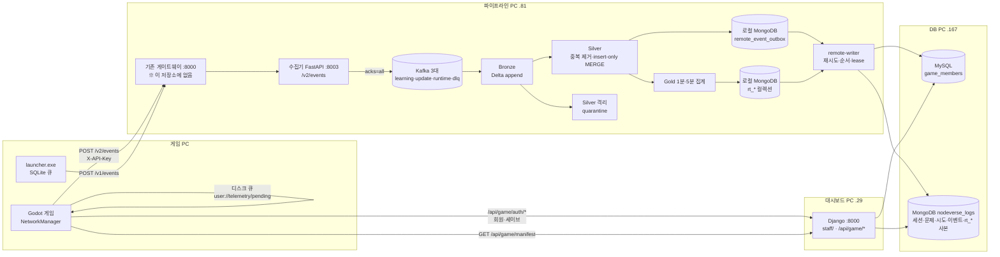

# 데이터 흐름과 보완·추가 구현 목록

기준: 통합 저장소 `main` (2026-11-20 16:00 KST, 게임 88394b1 · 파이프라인 32b0248 · 서버 3dfece8).
코드를 읽고 정리한 결과이며 전체 스택을 이 PC에서 실행해 확인한 것은 아닙니다. 줄 번호는 이 시점 기준입니다.

---

## 1. 전체 데이터 흐름

### 단계별 요약

| 단계 | 하는 일 | 실패 시 동작 (현재 코드) |
|---|---|---|
| 게임 송신 `game/scripts/network_manager.gd` | 이벤트를 디스크 큐에 저장 후 하나씩 POST, 3초 타임아웃 | 401·422 → `rejected/`로 옮기고 재전송 안 함. 그 밖의 오류 → 같은 event_id로 1~60초 지수 백오프 재시도 |
| 수집기 `pipeline/collector.py` | 키 확인 → JSON·스키마 검사 → 토픽 분류 → Kafka 전송 확인 후 202 | 잘못된 입력 → 422 + DLQ 토픽 기록. Kafka 실패 → 503(같은 본문으로 재전송 요청). 16KiB 초과 → 413 |
| Bronze `spark/delta_stream.py` | Kafka 원본을 그대로 Delta에 추가 | 체크포인트로 재시작 시 이어서. Kafka에서 지워진 오프셋이 있으면 중단(`failOnDataLoss=true`) |
| Silver | 필수 필드 확인, event_id 7일 중복 제거, insert-only MERGE, outbox 적재 | 같은 batch 재실행해도 행이 늘지 않음. 같은 ID·다른 내용은 격리 |
| Gold | 1분·5분 집계 후 Delta MERGE + Mongo `rt_*` upsert | Mongo upsert 실패 시 해당 쿼리 실패 → 앱 전체 종료 → 컨테이너 재시작 |
| remote-writer `pipeline/remote/worker.py` | outbox에서 하나씩 꺼내 원격 Mongo·MySQL에 관계형 문서로 적재, `rt_*` 5초마다 복사 | 일시 오류 → `retrying`(최대 60초 간격, 무한). 회원 매핑 없음 → `waiting_context`. 데이터 오류 → `blocked`(멈춤) |
| 서버 `server/telemetry/` | 원격 Mongo의 `rt_*`(실시간)와 세션·이벤트(분석)를 화면에 표시 | Mongo 접속 실패 시 화면 오류 |

---

## 2. 보완·추가 구현 목록

우선순위: **P0** 시연·운영 전에 꼭 필요 / **P1** 안정 운영에 필요 / **P2** 품질 개선.

### 파이프라인 — 예외 처리와 동작

| # | 우선 | 문제 | 근거 | 제안 |
|---|---|---|---|---|
| PL-1 | P0 | **실제 운영 경로의 게이트웨이 코드가 저장소에 없음.** 게임은 `.81:8000` 게이트웨이로 보내고 게이트웨이가 v2 수집기(8003)로 넘기는데, 이 구성(`pipeline/compose.yaml`, `compose.v2-bridge.yaml`, `outputs/compose.lan.yaml`)은 NVG 저장소의 옛 `pipeline/`과 개인 출력 폴더에 있음 | `pipeline/docs/LIVE_REMOTE_SINK.md` 9·74행 | 게이트웨이를 v2 수집기로 대체하거나, 브리지 설정을 `pipeline/gateway/`로 가져와 저장소만으로 재현 가능하게 |
| PL-2 | P0 | **Spark 쿼리 하나가 실패하면 7개 쿼리가 모두 멈춤.** `awaitAnyTermination()` 후 앱이 끝나고 Docker가 재시작. 원격이 아닌 로컬 Mongo가 잠깐 끊겨도 Gold·outbox 단계 예외로 Bronze 수집까지 함께 멈추고, Mongo가 계속 죽어 있으면 재시작이 반복됨(데이터는 Kafka 7일 보관으로 보존) | `delta_stream.py` 155·219·478행 | Mongo 쓰기를 별도 재시도(백오프) 또는 실패 기록 후 다음 배치로 넘기기, Bronze를 별도 앱으로 분리, 재시작 횟수 모니터링 |
| PL-3 | P0 | **수집기가 Kafka 장애 때 요청마다 최대 12초씩 스레드를 잡음.** 기본 스레드 풀(약 40개)이 차면 정상 요청과 `/health`까지 응답이 늦어짐 | `collector.py` 54·134행 | 전송 대기 시간을 줄이고(2~3초), 동시 처리 수 제한 + 빠른 503 반환, producer 큐 가득 참(BufferError) 별도 처리 |
| PL-4 | P1 | `_poll_forever` 스레드에 예외 처리가 없음. 이 스레드가 죽으면 전송 확인 콜백이 오지 않아 모든 요청이 12초 후 503 | `collector.py` 49행 | try/except로 감싸고 죽으면 재시작, `/health/ready`에서 확인 |
| PL-5 | P1 | 본문 크기 확인 전에 전체를 메모리로 읽음 | `collector.py` 105행 | `Content-Length` 먼저 확인, 스트리밍으로 16KiB에서 중단 |
| PL-6 | P1 | `GET /v2/events/{id}`는 로컬 Mongo가 죽으면 처리되지 않은 500 | `collector.py` 168행 | 503과 사유 반환 |
| PL-7 | P1 | `/health/ready`가 Kafka 연결만 보고 토픽 5개 존재·Mongo·Spark 진행 여부는 보지 않음 | `collector.py` 146행 | 토픽 확인, Spark 마지막 배치 시각을 `rt_summary`로 노출 |
| PL-8 | P1 | **DLQ를 읽는 쪽이 없음.** 422 이벤트는 `nv.dlq.v1`에 쌓이기만 하고 확인·재처리 수단이 없음. Silver 격리(`silver.quarantine`)도 마찬가지 | `collector.py` 69행, `delta_stream.py` 219행 | DLQ·격리 건수와 사유를 `rt_summary`나 서버 화면에 표시, 재처리 스크립트 |
| PL-9 | P1 | outbox의 `blocked`(데이터 오류)는 영구 정지, `retrying`은 무한 재시도, `waiting_context`(회원 매핑 대기)는 기한 없음. 알림도 없음 | `remote/worker.py` 132~146행 | 상태별 건수를 서버 화면에 노출, 최대 시도 횟수·기한 후 `blocked`로, 재처리 명령 제공 |
| PL-10 | P1 | outbox·conflict 컬렉션이 계속 커짐(정리 없음) | `remote/outbox.py` | `stored` 후 N일 지난 문서 TTL 인덱스 |
| PL-11 | P1 | `mirror_metrics`가 5초마다 `rt_*` 전체를 읽어 원격에 하나씩 씀. `rt_minigame_1m`은 1분마다 미니게임 수만큼 늘어나므로 시간이 갈수록 느려지고, 이 루프가 느리면 이벤트 적재도 같이 밀림 | `remote/worker.py` 50행 | `updated_at` 이후 변경분만 복사, bulk_write, 이벤트 처리와 다른 스레드로 분리 |
| PL-12 | P1 | outbox 적재가 이벤트마다 Mongo 왕복 2회, 원격 적재는 이벤트마다 MySQL 새 연결. 부하 시 Silver 배치 지연과 적재 지연의 원인 | `remote/outbox.py` 25행, `remote/worker.py` 118행 | bulk upsert, MySQL 연결 재사용(풀) |
| PL-13 | P1 | Gold 집계 워터마크 2분: 2~5분 늦게 도착한 이벤트(게임 오프라인 큐 재전송 등)는 실시간 집계에서 빠지고, 5분 넘게 늦으면 도착 시각 기준으로 엉뚱한 창에 들어감(Silver에는 정상 보존) | `delta_stream.py` 37·314행 | 의도한 동작인지 팀 합의 후 문서화, 필요하면 Silver 기준 일별 재집계 배치 |
| PL-14 | P1 | Kafka 보관 7일 + `failOnDataLoss=true`: 파이프라인이 7일 넘게 꺼져 있으면 Bronze가 시작되지 않음 | `delta_stream.py` 75행 | 복구 절차(체크포인트 재설정) 문서화 |
| PL-15 | P2 | 수집기에 요청 로그·지표가 없음(401·422·503 건수, 지연) | `collector.py` | 구조화 로그, 간단한 카운터 엔드포인트 |
| PL-16 | P2 | 인증 실패·대량 요청 제한 없음 | `collector.py` 89행 | IP별 속도 제한, 401 로그 |
| PL-17 | P2 | Delta `lake` 볼륨·체크포인트 백업 절차 없음 | `build_compose.py` | 정기 스냅샷 또는 백업 스크립트 |

### 게임

| # | 우선 | 문제 | 근거 | 제안 |
|---|---|---|---|---|
| GM-1 | P0 | **전송 큐 막힘.** 항상 큐 맨 앞 이벤트부터 보내므로, 그 이벤트가 401·422 이외 오류(413 본문 초과, 400, 404 등)를 계속 받으면 뒤의 모든 이벤트가 영원히 대기 | `network_manager.gd` 731·828행 | 4xx는 `rejected/`로 보내고 5xx·네트워크 오류만 재시도 |
| GM-2 | P0 | **401(키 오류)을 받은 이벤트를 영구 거부 처리.** 키 설정만 틀려도 그동안의 학습 기록이 모두 `rejected/`로 가고 키를 고친 뒤에도 다시 보내지 않음 | `network_manager.gd` 828행 | 401이면 전송을 멈추고 pending에 남겨 두기, 설정 변경 시 재개 |
| GM-3 | P0 | `player-login`이 수집기 주소로, 수집 키를 Bearer로 보냄 → 항상 실패 | `network_manager.gd` 244행 | Django 주소로, 클라이언트용 인증 방식으로 변경 또는 호출 제거(게임이 이미 회원 ID를 player_id로 보냄) |
| GM-4 | P1 | 6일 넘은 이벤트를 보내지 않는 규칙(파이프라인 README·D20)이 게임에 없음. 수집기에서 422 `too_old`로 거절되어 결국 `rejected/` | `network_manager.gd` (해당 로직 없음) | 전송 전 나이 확인 후 만료 처리 |
| GM-5 | P1 | 알 수 없는 미니게임 ID를 `ST01/DS`로 바꿔 보냄 → 배열 실습 통계 오염 | `network_manager.gd` 300~310행 | 전송하지 않고 로그 |
| GM-6 | P1 | 수집기·Django IP가 코드 기본값에 고정(`192.168.0.81`, `.29`) | `network_manager.gd` 30·33행 | 서버 manifest에서 주소 받기 또는 설치 시 설정 |
| GM-7 | P1 | `hint_step`을 보내지 않아 서버 화면에 "단계 None" 표시 | `LIVE_REMOTE_SINK.md` 남은 제한 5 | 송신 규약에 넣거나 화면에서 결측 처리 |
| GM-8 | P2 | 실행·종료 이벤트(run_*, exit_*)는 런처만 보냄. 게임 EXE를 런처 없이 실행하면 비정상 종료 통계가 비어 있음 | `pipeline/launcher.py` | 배포 시 런처 경유 실행 강제 또는 게임 내 최소 이벤트 |

### 서버

| # | 우선 | 문제 | 근거 | 제안 |
|---|---|---|---|---|
| SV-1 | P1 | outbox 상태(`waiting_context`, `blocked`, `retrying`)와 DLQ 건수를 볼 화면이 없음 | — | `staff/live`에 파이프라인 상태 카드 추가 (PL-8, PL-9와 함께) |
| SV-2 | P1 | `recovery_key` 평문 저장 | `server/telemetry/game_auth_api.py` 134행 | 해시 저장 |
| SV-3 | P2 | `server/docs/contracts/behavior-event.schema.json`이 옛 초안 | `contracts/README.md` | 삭제하고 `contracts/`를 참조 |
| SV-4 | P2 | CI가 문법 검사뿐 | `.github/workflows/server.yml` | MySQL·Mongo 서비스 컨테이너로 `manage.py test` |

### 공통·보안

| # | 우선 | 문제 | 제안 |
|---|---|---|---|
| CM-1 | P0 | Groq 키 폐기, 원본 저장소 Archive | 담당자 처리 |
| CM-2 | P0 | 코봇 채팅이 브라우저에서 Groq 직접 호출(`game/website/cobot-chat.js`, `server/website/`) | Django 프록시 엔드포인트 |
| CM-3 | P1 | 수집 키가 게임 클라이언트에 들어가는 구조(설치별 토큰 P7 전까지 알려진 제약) | 설치별 토큰 발급, 그 전까지 속도 제한 |
| CM-4 | P1 | 네 PC의 시간이 어긋나면 `occurred_at` 미래 5분 초과 거절·창 오배치 | 모든 PC NTP 동기화 확인 |
| CM-5 | P2 | 이벤트 계약이 `pipeline/contract.py`, `contracts/`, 서버 스키마 세 곳 | `contracts/`를 단일 기준으로, 파이프라인이 import |
| CM-6 | P2 | 웹 대시보드 체험 암호 `nd1234`(클라이언트 비교) | 데모 전용 표시 또는 제거 |

---

## 3. 이 PC(Windows ARM)에서 실행 가능 여부

확인일 2026-11-20. 설치는 하지 않고 상태만 확인했습니다.

| 항목 | 결과 |
|---|---|
| OS·CPU | Windows 11 Pro build 28000, **ARM64** (NVIDIA N1X 20코어), RAM 30GB, 여유 디스크 785GB |
| 가상화 | 하이퍼바이저 켜짐, **WSL2 설치됨** (Ubuntu 24.04, 현재 중지 상태) |
| Docker | 설치 안 됨. Docker Desktop은 Windows ARM64를 지원하고 WSL2 백엔드로 동작 |
| 파이프라인 이미지 | `apache/kafka:3.9.1`, `mongo:7.0.16`, `apache/spark:3.5.3-python3`, `python:3.11-slim` 모두 **linux/arm64 이미지 제공** (Docker Hub 매니페스트 확인) |
| 컨테이너 안 Python 패키지 | `confluent-kafka 2.8.0`은 Linux aarch64 wheel이 있어 컨테이너 빌드 가능 |
| Windows에서 직접 | `confluent-kafka`는 Windows ARM용 wheel이 없음(최신 2.16.2도 win_amd64만) → **Windows에서 직접 pytest는 불가**, WSL Ubuntu나 컨테이너 안에서는 가능 |
| MongoDB | Windows용 MongoDB 서버는 x64 전용이라 ARM에서는 에뮬레이션으로만 동작(공식 미지원). **Docker 컨테이너(`mongo:7.0.16` arm64) 또는 WSL Ubuntu 설치를 권장** |

결론: **Docker Desktop을 설치하면 파이프라인 전체(Kafka·Spark·MongoDB·수집기)를 이 PC에서 그대로 돌릴 수 있습니다.** 메모리도 충분합니다(Spark 2GB + Kafka 3대 + Mongo). 단위 테스트는 WSL Ubuntu에서 실행하면 됩니다.
Docker Desktop 설치에는 관리자 권한과 재부팅이 필요할 수 있고, 회사·기관 PC라면 Docker Desktop 라이선스 조건(직원 250명 이상 또는 매출 기준)을 확인해야 합니다.
