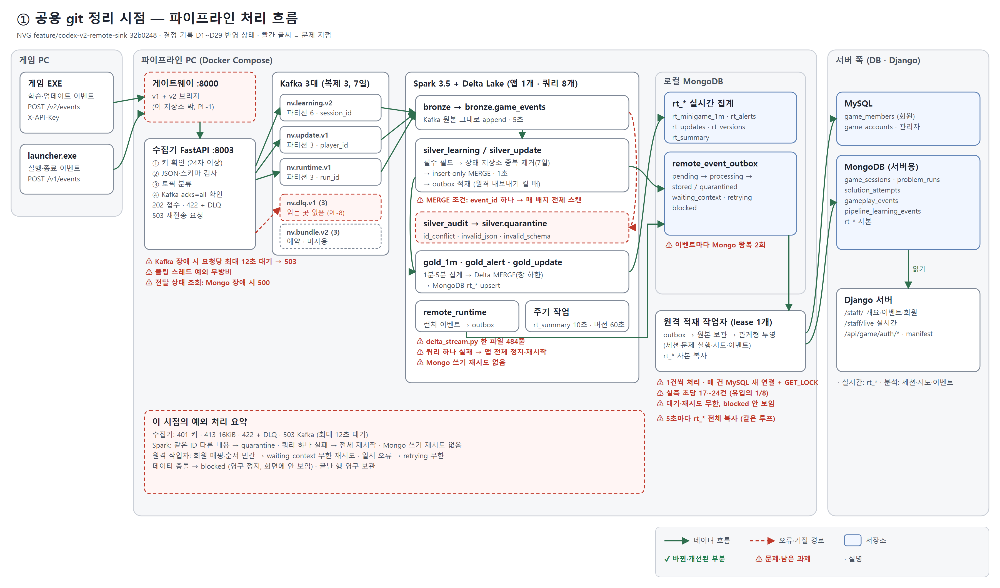
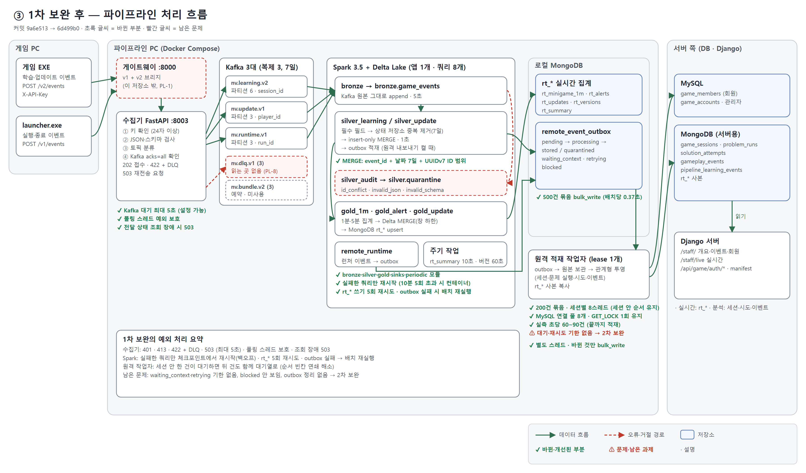
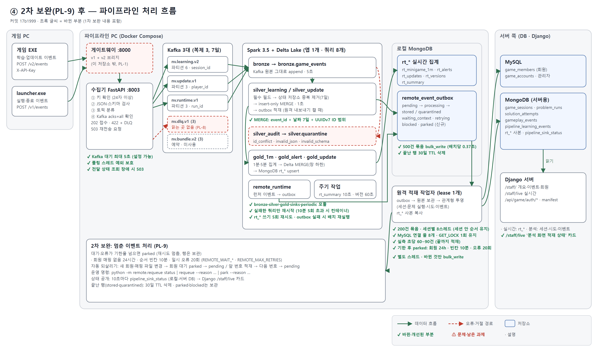

# NODEVERSE 변경 리포트 (2026-11-20)

- 대상 저장소: `encore-ai-campus/mlo-02-p3-team1`
- 시점 구분
  - **공용 git 정리 시점:** 세 파트를 통합 저장소에 합친 직후. 파이프라인은 NVG `feature/codex-v2-remote-sink` 32b0248, 담당자 결정 기록 D1~D29까지 반영된 상태.
  - **1차 보완:** D29 상태의 코드를 기준으로 한 첫 보완. 커밋 `9a6e513` → `6d499b0` (17:46~19:03 KST)
  - **2차 보완:** PL-9(멈춘 이벤트 처리). 커밋 `17b1999` (22:18 KST)
- 수치는 이 PC(Windows 11 ARM64 20코어, WSL2 Docker, Spark 4코어)에서 직접 잰 값입니다. 운영 환경 값은 아닙니다.
- 문제 번호(PL-·BN-·GM-·SV-·CM-·RF-)는 `docs/DATA_FLOW_AND_GAPS.md`의 항목 번호입니다.

---

## 1. 공용 git 정리 시점의 파이프라인 상태

### 1-1. 토픽 (`pipeline/topics.py`, Kafka 3대 · 복제 3 · 최소 ISR 2 · 보관 7일)

| 토픽 | 파티션 | 키 | 내용 |
|---|---|---|---|
| `nv.learning.v2` | 6 | session_id | 학습 이벤트 8종 (problem_started … problem_completed) |
| `nv.update.v1` | 3 | player_id | 업데이트 이벤트 9종 (update_checked … build_changed) |
| `nv.runtime.v1` | 3 | run_id | 런처 실행·종료 이벤트 (run_*, exit_*) |
| `nv.dlq.v1` | 3 | event_id | 수집기가 422로 거절한 원문(4KB까지)과 사유 |
| `nv.bundle.v2` | 3 | — | 예약(생산자·소비자 없음, D2) |

### 1-2. 처리 흐름

(원본 SVG: `docs/reports/images/flow-1-consolidation.svg`)

### 1-3. 예외 처리

| 위치 | 상황 | 처리 |
|---|---|---|
| 수집기 | 키 틀림 | 401 |
| 수집기 | 본문 16KiB 초과 | 413 (본문을 먼저 다 읽은 뒤 확인) |
| 수집기 | 깨진 JSON·스키마 오류·모르는 event_type·6일 초과 | 422 + DLQ 토픽 기록 (DLQ 기록 실패 시 `dlq:false`) |
| 수집기 | Kafka 전송 실패·지연 | 요청 스레드가 **최대 12초** 대기 후 503 (같은 event_id로 재전송 요청) |
| 수집기 | Kafka 폴링 스레드 예외 | 처리 없음 (스레드가 죽으면 모든 요청이 12초 후 503) |
| 수집기 | 전달 상태 조회 중 Mongo 장애 | 처리 없음 → 500 |
| Spark | 쿼리 하나 실패 | `awaitAnyTermination` → **앱 전체 종료** → Docker 재시작 (Bronze 수집까지 멈춤, 데이터는 Kafka 7일 보관으로 보존) |
| Spark | Mongo rt_* 쓰기 실패 | 재시도 없음 → 해당 쿼리 실패 → 위와 같음 |
| Spark | 같은 ID 다른 내용 | silver.quarantine `id_conflict` |
| 원격 작업자 | 회원 매핑 없음·순서 빈칸 | `waiting_context`, **기한 없이** 5~60초 간격 무한 재시도 |
| 원격 작업자 | 일시 오류 | `retrying`, **횟수 제한 없이** 재시도 |
| 원격 작업자 | 데이터 충돌 | `blocked` (영구 정지, 어디에도 표시 안 됨) |
| 원격 작업자 | 끝난 행 | 지우지 않음 (outbox 계속 증가) |

---

## 2. 보완 전 코드에서 발생할 수 있었던 문제

### 2-1. 성능·병목 (부하 시험 실측: 학습 이벤트 4.2만 건, 초당 약 175건)

| 번호 | 문제 | 근거·실측 |
|---|---|---|
| BN-5 | **원격 적재가 유입을 따라가지 못함** | 초당 17~24건 처리 (유입의 약 1/8). 부하 종료 시 대기 35,230건, 소화에 30분 이상 → 분석 화면이 수십 분 늦음 |
| BN-7 | 지표 복사가 시간이 갈수록 느려짐 | 5초마다 rt_* 전체 복사, 적재 루프와 같은 스레드 |
| BN-8 | Silver 배치 안 outbox 적재 | 이벤트마다 Mongo 왕복 2회, 드라이버에서 한 건씩 |
| BN-1 | Silver MERGE가 매번 Silver 전체를 읽음 | 조건이 `event_id` 하나뿐, 날짜 파티션·ID 통계 활용 불가 (D23 메모에도 D19 성능 설명 미적용 명시) |
| BN-2·3 | Gold 로그·작은 파일 누적 | 1초 트리거 커밋, OPTIMIZE 수동 |
| BN-9 | 수집기 스레드 점유 | Kafka 장애 시 요청당 12초 |
| BN-4 | 지연 근거 부족 | 클라우드 10~53초(CPU 포화), 로컬 12.89초 1회 → 로컬 재측정 결과 평시 5~9초, 부하 중 8.6~12.1초 (15초 목표 통과) |

### 2-2. 안정성·예외 처리

| 번호 | 문제 | 영향 |
|---|---|---|
| PL-2 | 쿼리 하나 실패 = 전체 정지 | 로컬 Mongo가 잠깐 끊겨도 Bronze 수집까지 멈춤, 재시작 반복 |
| PL-3·4 | 수집기 12초 대기, 폴링 스레드 무방비 | Kafka 장애 시 정상 요청·상태 확인까지 지연 |
| PL-6 | 전달 상태 조회 500 | Mongo 장애 시 원인 불명 오류 |
| PL-9 | 멈춘 이벤트가 영원히 재시도·보이지 않음 | CPU 낭비(쉬는 중 143% 관측), 운영자가 알 수 없음 |
| PL-10 | outbox 무한 증가 | 디스크·조회 비용 증가 |
| BN-6 | 세션 순서 빈칸이 생기면 그 세션 전체 정지 | 뒤 이벤트가 각자 백오프로 대기 |
| PL-8 | DLQ·격리를 읽는 곳 없음 | 거절 이벤트 확인 불가 |
| PL-1 | 운영 게이트웨이 설정이 저장소에 없음 | 저장소만으로 운영 경로 재현 불가 |
| (검토서 5절) | Silver MERGE에 짧은 날짜 범위를 붙이면 늦은 재전송을 놓칠 위험 | 1차 보완 중 ±1일로 넣었다가 7일로 바로잡음 |

### 2-3. 게임 송신 쪽에서 파이프라인에 영향을 준 문제

| 번호 | 문제 |
|---|---|
| GM-1 | 큐 맨 앞 이벤트가 4xx(413 등)를 받으면 뒤 이벤트 전부 정지 |
| GM-2 | 401(키 오류) 이벤트를 영구 거부 → 키를 고쳐도 재전송 안 됨 |
| GM-3 | player-login이 수집기 주소로 수집 키를 보내 항상 실패 |
| GM-4 | 6일 지난 이벤트를 보내 `too_old`로 거절됨 |
| GM-5 | 모르는 미니게임 ID를 ST01로 바꿔 배열 통계 오염 |
| GM-9 | 테스트 봇이 첫 컴퓨터에서 영원히 멈춤 |

---

## 3. 1차 보완 후 파이프라인 상태

### 3-1. 토픽

변경 없음 (1-1과 같음). 이벤트 형식(`contract.py`)도 변경 없음. 게임 이벤트 ID가 UUIDv7(시간순)로 바뀌었지만 같은 UUID 문자열 형식입니다.

### 3-2. 처리 흐름

(원본 SVG: `docs/reports/images/flow-3-after-fix1.svg`)

### 3-3. 예외 처리

| 위치 | 상황 | 1차 보완 후 |
|---|---|---|
| 수집기 | Kafka 지연 | 최대 5초 대기 후 503 |
| 수집기 | 폴링 스레드 예외 | 로그 남기고 계속 폴링 |
| 수집기 | 전달 상태 조회 중 Mongo 장애 | 503 + 사유 |
| Spark | 쿼리 하나 실패 | **그 쿼리만** 체크포인트에서 재시작(백오프 2~30초). 10분 안 5회 초과 시 컨테이너 재시작 |
| Spark | rt_* 쓰기 실패 | 5회 재시도 후 로그 남기고 배치 통과 (Gold Delta는 정확, 다음 갱신 때 복구) |
| Spark | outbox 쓰기 실패 | 재시도 후에도 실패하면 배치 재실행 (이벤트를 건너뛰지 않음) |
| Spark | 실패·재시작 기록 | `/data/metrics/streaming-progress.json`의 `sink_failures`, `query_restarts` |
| 원격 작업자 | 세션 안 한 이벤트 대기 | 같은 세션의 뒤 이벤트를 같은 시각으로 대기열에 되돌림 (각자 백오프로 실패하지 않음) |
| 원격 작업자 | 대기·재시도 기한 | **여전히 없음** (→ 2차 보완) |

### 3-4. 1차 보완 결과 (실측)

| 항목 | 보완 전 | 1차 보완 후 |
|---|---|---|
| 원격 적재 (회원 매핑 대기로 끝나는 처리) | 초당 17~24건 | 초당 248건 |
| 원격 적재 (끝까지 적재) | 뒤처짐 | 초당 약 60~90건, 3만 건 중 29,900건 이상 `stored`, `blocked` 0 |
| Silver 배치 중 outbox 적재 | 배치 대부분 | 0.37초 |
| 대시보드 반영 지연 | 12.89초 1회 | 최대 10.1~11.1초 (부하 중) |
| 수집 | — | 3만 건 전부 202, p50 23ms |
| Silver MERGE | 평균 3.75초 (Silver 약 8만 행) | 평균 5.25초 (같은 날 파티션 약 14만 행). 날짜에 무작위 v4 ID가 섞여 ID 범위로 건너뛸 파일이 없음 → v7만 쌓인 새 레이크에서 재측정 필요 |
| 단위 테스트 | 41개 | 55개 |

---

## 4. 2차 보완 (PL-9)

### 4-1. 1차 보완 후에도 남아 있던 문제

| 문제 | 실제 관측 |
|---|---|
| `waiting_context`가 기한 없이 재시도 | 앞 번호가 `blocked`된 세션의 뒤 이벤트 2,245건이 영원히 `sequence_gap` 대기. 쉬는 중에도 작업자가 재시도 |
| `retrying` 횟수 제한 없음 | DB 장애가 길어지면 무한 재시도 |
| `blocked`·대기 건수를 볼 수 없음 | 서버 화면에 표시 없음 |
| outbox 무한 증가 | 시험 후 10만 건 이상 누적 |

### 4-2. 2차 보완 후 상태

**토픽:** 변경 없음.

**처리 흐름** (아래쪽 상자가 2차 보완으로 추가된 부분)

(원본 SVG: `docs/reports/images/flow-4-after-pl9.svg`)

**예외 처리 (원격 작업자 상태)**

| 상태 | 의미 | 다음 |
|---|---|---|
| `pending` → `processing` | 처리 대기·처리 중 | |
| `stored` / `quarantined` | 적재 완료 / 격리 적재 | 30일 뒤 삭제 |
| `waiting_context` | 회원 매핑·앞 번호 대기 (기한 안) | 5~60초 간격 재시도 |
| `retrying` | 일시 오류 (20회 안) | 2~60초 간격 재시도 |
| `parked` (신규) | 기한·횟수 초과, 재시도 멈춤 | 조건이 되면 자동, 또는 명령으로 `pending` |
| `blocked` | 데이터 충돌 | 즉시 정지 (기존과 같음), 화면에 건수·사유 표시 |

**확인 결과 (로컬)**

- 쌓여 있던 대기 2,252건이 10분 기한 뒤 자동으로 `parked` → 재시도 중단
- 서버 화면 카드: "적재 완료 97,322 · 보관(재시도 멈춤) 2,252 · 데이터 오류 2,245" (`docs/screenshots/server-4-live-sink.png`)
- 테스트: 파이프라인 58개(+4), 서버 56개 통과

### 4-3. 2차 보완 후에도 남은 과제

| 번호 | 내용 |
|---|---|
| BN-5 | 끝까지 적재(초당 60~90건)가 유입(150~185건)보다 느림 → 투영 코드의 이벤트당 Mongo 왕복(약 10회) 축소 |
| BN-1 | Silver MERGE: v7만 쌓인 새 레이크에서 효과 측정, 부족하면 D19(append) 복귀 또는 ZORDER 정기 실행 |
| PL-1 | 운영 게이트웨이 설정을 저장소로 |
| PL-8 | DLQ·격리 건수를 서버 화면에 |
| RF-9·10 | Spark 처리 로직 단위 테스트, 시험 스크립트 정리 |

---

## 5. 파이프라인 코드 외 변경 전체

### 5-1. 저장소 구성 (공용 git)

| 내용 | 커밋·위치 |
|---|---|
| 통합 저장소 구성: `game/`·`pipeline/`·`server/`를 원본 커밋 기록째 합침(git filter-repo), `contracts/`·`docs/` 추가 | 초기 커밋들, `d085fa1` "[코드정리] git 코드 초기화" |
| 게임 원본 기록에서 **Groq API 키 제거**, 게임 바이너리 974개 Git LFS 전환 | 게임 가져오기 단계 |
| 루트 `.gitignore`(비밀값·빌드물·Godot 실행 파일), `.gitattributes`(LFS·줄바꿈), `nodeverse.code-workspace` | 초기 커밋 |
| GitHub Actions: 파이프라인(단위 테스트 + compose 생성물 검사 + 컴파일), 서버·게임(골격) | `.github/workflows/` |
| 세 파트 최신화: 게임 88394b1, 서버 3dfece8, 파이프라인 32b0248(remote-sink 브랜치로 전환) | `fdbe457`, `3c2e70d` 등 |

### 5-2. 게임 (`game/scripts/`)

| 변경 | 파일 |
|---|---|
| 이벤트 ID UUIDv7 (`generate_uuid_v7`) | `network_manager.gd` |
| 응답별 처리: 401은 보관 후 60초 재시도, 그 밖의 4xx는 rejected, 408·429·5xx·네트워크는 재시도 (GM-1·2) | `network_manager.gd` |
| 6일 지난 이벤트 로컬 만료 (GM-4) | `network_manager.gd` |
| 모르는 미니게임 ID는 전송 안 함 (GM-5) | `network_manager.gd` |
| player-login 비활성화 (GM-3) | `network_manager.gd` |
| 테스트 봇 멈춤 수정: 월드가 트리에서 빠졌는지 확인, 컴퓨터 근처에서 상호작용 생략 (GM-9) | `tools/live_test_bot_overlay.gd` |

### 5-3. 서버 (`server/`)

| 변경 | 파일 |
|---|---|
| 빈 DB에서 실패하던 마이그레이션 순서 수정 (`accounts.0005` → `sessions` 의존) | `accounts/migrations/0005_…` |
| recovery_key를 HMAC-SHA256으로 저장, 기존 평문은 마이그레이션·사용 시 변환 (SV-2) | `telemetry/game_auth_api.py`, `telemetry/migrations/0010_hash_recovery_keys.py` |
| 실시간 화면 "분석 화면 적재 상태" 카드 (PL-9·SV-1) | `telemetry/live.py`, `templates/telemetry/live.html`, `static/js/live.js` |
| 테스트 보강 (해시 저장, 옛 평문 계정 전환) | `telemetry/test_server_part.py` |

### 5-4. 문서

| 문서 | 내용 |
|---|---|
| `README.md` | 개요 · 저장소 구성(하위 폴더와 각 README) · 파트별 동작·데이터 규약 · 종합 구조(아키텍처 그림) · 실행 화면 · 추후 예정 |
| `docs/SETUP_GUIDE.md` | clone 후 파트별 개발환경 구성 |
| `docs/LOCAL_RUN_WINDOWS_ARM.md` | 한 PC에서 전체 실행, DB 조회, WSL 메모리 설정 |
| `docs/DATA_FLOW_AND_GAPS.md` | 데이터 흐름, 병목(실측), 보완 목록, 리팩토링 검토 |
| `docs/INTEGRATION_REVIEW_2026-11-20.md` | 세 파트 연동 검토 |
| `docs/architecture/data-flow-2026-11-20.svg·png` | 현재 데이터 흐름 아키텍처 그림 |
| `docs/changes/2026-11-20_{game,pipeline,server}.md` | 파트별 변경 구현서 (AI 에이전트 학습용) |
| `docs/reports/` | 중간보고서·델타레이크 오류수정내역·로그인 정리 PDF, 이 리포트 |
| `docs/screenshots/` | 게임 3장, 파이프라인 1장, 서버 4장 |
| 삭제 | `docs/BRANCH_STRATEGY.md`, 파트별 구현 지시서 PDF(`docs/instructions/`) |

### 5-5. 로컬 실행 환경 (이 PC)

| 변경 | 위치 |
|---|---|
| WSL2 Ubuntu에 Docker 엔진 설치 (Docker Desktop 대신) | WSL |
| 원클릭 스크립트 `전체실행.cmd`·`전체중지.cmd`·`상태확인.cmd` + `scripts/local/up.sh·down.sh·status.sh` | 저장소 루트 |
| MySQL 8.4 컨테이너, Django를 WSL systemd 서비스(127.0.0.1:8010)로 | 로컬 |
| DB 조회 화면 mongo-express(8081)·Adminer(8082), `DB조회화면.cmd`·`DB조회_몽고.cmd`·`DB조회_MySQL.cmd` | `scripts/local/dbui.sh`, 루트 |
| 수만 건 시험용 더미 데이터 `pipeline/tools/dummy_data.py` | 파이프라인 도구 |
| `.wslconfig`: 유휴 종료 끔, 메모리 상한 12GB, 캐시 즉시 반환 (Windows 여유 메모리 4.5GB → 11.9GB) | `%USERPROFILE%\.wslconfig` (백업 2개) |
| 바탕화면 PDF `NODEVERSE_DB조회_방법.pdf`, Compass 연결 파일, DBeaver 연결 미리 등록 | 바탕화면, DBeaver 설정 폴더 |
| `.env` 파일들(키·비밀번호)은 이 PC에서 새로 생성, git에서 제외 | `pipeline/.env*`, `server/.env*` |

### 5-6. push 상태

- 공용 저장소 `main`: `a35e7ca`까지 반영
- 로컬에만 있는 커밋 6개(이 리포트 작성 전 기준): `50915b7` Silver 7일 범위, `b585381` DB 조회 화면, `6d499b0` 세 파트 보완, `3b885f4` 구현서, `58f5720` WSL 메모리 문서, `17b1999` PL-9 — push 승인 대기
