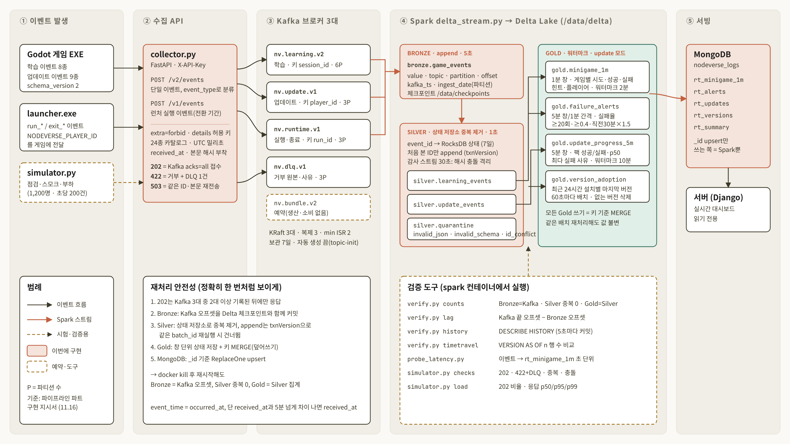

# NODEVERSE 파이프라인

게임 이벤트 → 수집 API(`POST /v2/events`) → Kafka 브로커 3대 → Spark Structured Streaming → Delta Lake(Bronze·Silver·Gold) → MongoDB 실시간 컬렉션(`rt_*`)까지 이어지고, Silver를 통과한 이벤트는 원격 작업자가 대시보드용 MySQL·MongoDB에 적재합니다. 읽기 전용 관측소(:8011)가 처리 상태와 경고를 보여 줍니다.

기준 문서는 「NODEVERSE 파이프라인 파트 구현 지시서」(공통 계약 포함)이고, 지시서와 다르게 정한 부분은 [docs/DECISIONS.md](docs/DECISIONS.md)에 있습니다.

압축·사전 코드화는 **향후 데이터 규모 확대 시 적용 여부를 재검토할 확장 설계**로 남깁니다. 기존 실시간 JSON 전송은 유지하며, 오프라인 gzip·사전 수신은 참조 구현·격리 시험 단계입니다. 운영 활성화·EXE 자동 연결·전체 로그 자동 코드화가 완료된 상태는 아닙니다. 현재 범위와 실측 근거는 [압축·사전 확장 설계](docs/COMPRESSION_EXTENSION.md)를 참고하세요.



쿼리·상태·보완 차수까지 담은 상세 그림은 [docs/architecture/pipeline-architecture-2026-11-25.png](../docs/architecture/pipeline-architecture-2026-11-25.png)입니다. 개요 그림은 `python docs/render_architecture.py`, 상세 그림은 저장소 루트의 `python docs/architecture/pipeline_architecture.py`로 SVG를 다시 만들고 헤드리스 브라우저로 PNG를 렌더링합니다.

## 구성

| 파일·폴더 | 역할 |
|---|---|
| `topics.py`, `build_compose.py` → `compose.json` | 토픽 5개(파티션 6/3/3/3/3, 보관 7일, 복제 3·min ISR 2)와 서비스 정의. `compose.json`은 직접 고치지 않고 `python build_compose.py`로 다시 만듭니다 (CI가 차이를 검사) |
| `contract.py`, `collector.py`, `Dockerfile` | `/v2/events` 검사·분류·Kafka 접수 후 202, 422 + DLQ, 503 재전송 안내, `/v1/events`(런처 실행 이벤트), `/health/ready`·`/health/deps` |
| `common/` | 설정(`settings.py`, 환경 변수 한곳), DB 연결, 기동 관문·상태 확인(`health.py`), 늦은 이벤트 기준(`lateness.py`), 단계별 시간 기록 |
| `spark/delta_stream.py` | Spark 앱 진입점·감독. 실패한 쿼리만 체크포인트부터 재시작하고, 한 쿼리가 10분에 5회 넘게 실패하면 컨테이너를 재시작합니다 |
| `spark/bronze.py`, `silver.py`, `gold.py` | Bronze append, Silver 중복 제거·insert-only MERGE·격리 감사, Gold 1분·5분 창 집계 |
| `spark/periodic.py`, `sinks.py`, `compaction.py` | 드라이버 주기 작업(`rt_summary`·`rt_versions`·`rt_rejects`), MongoDB 게시·재시도·재게시, 작은 파일 압축·VACUUM |
| `spark/tables.py`, `audit_state.py`, `maintain.py` | Delta 테이블 배치와 스키마, 해시 충돌 감사 상태 함수, 정비 시간용 OPTIMIZE/ZORDER |
| `remote/` | 원격 작업자(remote-writer): outbox 선점, 세션 순서대로 투영, 회원·게스트 확인, rt_* 사본, 상태 집계, `requeue` 도구 |
| `observatory/`, `Dockerfile.observatory` | 읽기 전용 관측소(FastAPI :8011)와 알림 센터 |
| `simulator.py`, `spark/verify.py`, `spark/probe_latency.py` | 계약 점검·스모크·부하 송신, 행 수 대조·히스토리·타임 트래블, 수집→화면 지연 측정 |
| `tools/` | DLQ 조회, 더미 데이터, 상태 객체 DLQ 복구(`recover_state_dlq.py`), 실행 코드 일치 확인(`check_runtime_source.py`), 중복 제거·Silver·outbox 실험 도구 |
| `launcher.py`, `build_launcher.cmd` | 실행 런처(실행·하트비트·종료 이벤트, `NODEVERSE_PLAYER_ID` 전달) → launcher.exe |
| `compose.*.yaml` | 운영 스택 코드 갱신 override(`compose.runtime-source.yaml`), 관측소만 붙이기, 격리된 실험·복구 시험용 Compose 파일 |

## 처리 흐름

| 단계 | 주기 | 하는 일 |
|---|---|---|
| 수집기 | 요청마다 | 키 확인 → 계약 검사 → 토픽 분류 → Kafka `acks=all` 확인 후 202. 잘못된 입력은 422와 DLQ 1건, Kafka 실패(5초)는 503 |
| `bronze` | 5초 | 학습·업데이트·실행 토픽을 원문 그대로 `bronze.game_events`에 append (`maxOffsetsPerTrigger` 10,000) |
| `silver_learning_events`, `silver_update_events` | 1초 | 상태 저장소로 `event_id` 중복 제거(기본 168시간) → 날짜 7일·UUIDv7 ID 범위로 좁힌 insert-only MERGE → outbox 적재 → 작은 파일 압축 |
| `silver_audit` | 30초 | `topic:event_id`별 본문 해시를 기억해 같은 ID 다른 본문(`id_conflict`)과 JSON·스키마 오류를 `silver.quarantine`에 원문째 보관 |
| `gold_1m`, `gold_alert`, `gold_update` | 1초 | 1분 미니게임 집계, 5분 실패 급증 경고, 5분 업데이트 진행. Delta MERGE → MongoDB 게시 → 압축 순서 |
| 주기 작업 | 10·60초 | `rt_summary`(10초), 버전 보급률·`rt_rejects`(60초), Gold 재게시, Bronze 압축(10분), VACUUM(6시간), 진행 파일 기록 |
| `remote_runtime` | 1초 | `REMOTE_EXPORT_ENABLED=1`일 때 실행 이벤트를 outbox로 |
| remote-writer | 상시 | outbox 200건 묶음 선점 → 세션별 8스레드로 순번대로 세션·문제 실행·시도·행동 로그 적재 |

**보장과 기준**
- **유실 방지:** 202는 Kafka 3대 중 2대 이상에 기록된 뒤에만 돌려줍니다. Kafka가 7일 보관하므로 Spark가 멈춰도 체크포인트부터 이어서 처리합니다.
- **중복 방지:** 같은 `event_id` 재전송은 Silver에서 걸러지고, insert-only MERGE라 다시 실행해도 행이 늘지 않습니다. 원격 적재의 모든 쓰기는 같은 내용만 통과시키고 다르면 충돌로 멈춥니다.
- **늦게 도착한 이벤트:** 플레이 시각과 도착 시각이 일정 간격 넘게 차이 나면 실시간 건수에는 넣되 따로 세고, 실패 급증 경고에서는 뺍니다. 경고 기준선(직전 30분 6개 창)도 `gold.failure_alerts`에서 현재 창과 같은 규칙으로 읽습니다.
- **압축:** Delta 자동 압축은 끄고, 각 테이블을 쓰는 스레드가 `COMPACT_EVERY_BATCHES`(300)배치마다 그 배치가 쓴 파티션의 작은 파일만 합칩니다. Silver는 outbox 적재 뒤, Gold는 MongoDB 게시 뒤에 압축하므로 원격 적재와 화면 게시가 압축을 기다리지 않습니다.
- **상태 객체:** 배포 게임이 `details.state_before`/`state_after`를 JSON 객체로 보내면 수집기가 키 순서를 고정한 JSON 문자열로 바꿉니다. 512자 제한과 `details` 크기 제한은 그대로입니다.
- **지연:** 이벤트가 `rt_*`에 반영되기까지 평시 약 10~18초입니다(D22).

Delta 테이블(`/data/delta`, 볼륨 `lake`): `bronze.game_events`, `silver.learning_events`, `silver.update_events`, `silver.quarantine`, `gold.minigame_1m`, `gold.failure_alerts`, `gold.update_progress_5m`, `gold.version_adoption`.

로컬 MongoDB(`nodeverse_logs`): `rt_minigame_1m`, `rt_alerts`, `rt_updates`, `rt_versions`, `rt_summary`, `rt_rejects`(Spark만 씀, `_id` upsert), `remote_event_outbox`와 원격 적재 상태 컬렉션, `pipeline_sink_status`, `observatory_samples`(관측소 표본, 48시간 TTL).

## 원격 적재 (remote-writer)

`--profile remote`로 켜고, 비공개 `.env.remote`(예시: `remote/remote.env.example`)와 `.env.remote-context.json`이 필요합니다. 자세한 운영 경로는 [docs/LIVE_REMOTE_SINK.md](docs/LIVE_REMOTE_SINK.md)에 있습니다.

- 작업자는 lease로 한 프로세스만 돌고, 안에서 세션별로 병렬 처리합니다. 같은 세션의 이벤트는 `sequence` 순서대로만 적재합니다.
- 상태: `pending → processing → stored / quarantined`. 앞 순번이나 회원 매핑을 기다리면 `waiting_context`(앞 순번 10분, 회원 24시간 뒤 `parked`), 일시 오류는 `retrying`(20회 뒤 `parked`), 데이터 충돌은 `blocked`입니다. 완료 행은 30일 뒤 지워집니다.
- **게스트:** `REMOTE_ALLOW_GUESTS=1`일 때만 등록 회원에 없는 `guest:<UUID>`나 유효한 원시 UUID 플레이어를 `game:member:guest:<UUID>` 키의 게스트 회원으로 만듭니다. 실제 회원과 명시적 매핑이 우선이고, 영 UUID·잘못된 guest UUID는 격리합니다. 기본값은 꺼짐입니다.
- 회원 확인 캐시는 `REMOTE_MEMBER_CACHE_SECONDS`(기본 300초, 0이면 매번 확인)이고 최대 5만 건까지 보관합니다.
- 멈춘 이벤트 확인·재개: `python -m remote.requeue status | requeue | park`

## 관측소 (observatory)

수집기 준비 상태, 쿼리별 처리 속도·배치 시간, 적재 상태별 건수와 최대 대기, 15분~6시간 추이, 경고·복구 이력을 한 화면에서 봅니다. Spark 진행 파일과 로컬 MongoDB를 읽기만 하고 업무 데이터를 바꾸는 API는 없습니다.

```powershell
docker compose -p <프로젝트> --env-file .env -f compose.json --profile observatory up -d --no-deps --build observatory
# 이미 떠 있는 스택에 관측소만 붙일 때
docker compose -f compose.observatory.attach.yaml up -d --build
```

기본 주소는 `http://127.0.0.1:8011/`입니다. LAN에 열려면 `OBSERVATORY_BIND`와 함께 별도 `OBSERVATORY_KEY`를 비공개 설정으로 지정해야 하며, 키 없이 LAN 바인딩하면 시작하지 않습니다. 대기 시간 조회용 인덱스는 관측소 컨테이너에서 `python -m observatory.setup_indexes --execute`로 만듭니다. 화면 설명과 경고 기준은 [docs/OBSERVATORY.md](docs/OBSERVATORY.md), [docs/OBSERVATORY_ALERTS.md](docs/OBSERVATORY_ALERTS.md)에 있습니다.

## 실행

Docker Desktop(Linux 엔진)을 켜고 이 폴더에서 PowerShell로 실행합니다. 첫 실행에는 이미지와 Spark 패키지를 받기 위해 인터넷이 필요합니다. 설정 파일 조합으로 서로 다른 볼륨의 스택을 나눠 띄웁니다.

| 용도 | 설정 | 수집기 · MongoDB |
|---|---|---|
| 기본 | `.env` | 8000 · 27017 |
| 격리 검토·시험 | `.env` + `review.env` (`nodeverse-v2-review`) | 8002 · 27019 |
| 실제 수집 + 원격 적재 | `.env` + `live.env` (`nodeverse-v2-live`, `REMOTE_EXPORT_ENABLED=1`) | 8003 · 27020 |

```powershell
# 1) .env.example을 .env로 복사하고 INGEST_KEY를 24자 이상 임의 값으로 바꿉니다
# 2) 서비스 정의를 바꿨다면 다시 생성 (python만 있으면 됨)
python build_compose.py
# 3) 격리 검토 스택 시작
docker compose -p nodeverse-v2-review --env-file .env --env-file review.env -f compose.json up -d --build
docker compose -p nodeverse-v2-review --env-file .env --env-file review.env -f compose.json logs -f spark      # "started queries: [...]" 확인
# 실제 수집 + 원격 적재 (.env.remote 필요)
docker compose -p nodeverse-v2-live --env-file .env --env-file live.env -f compose.json --profile remote up -d --build
```

운영 PC에서는 기존 게이트웨이(:8000)가 `/v2/events`를 내부 수집기(:8003)로 넘깁니다. 게이트웨이 설정은 이 저장소에 없습니다. 읽기 전용 사전 점검은 `python check.py`(키 값 출력·시험 이벤트 전송 없음)입니다.

**운영 스택의 코드 갱신:** 운영 PC의 Spark·collector·remote-writer는 이 저장소의 분리형 모듈로 동작하며, 기존 `nodeverse-v2-live` 볼륨과 체크포인트 8개를 그대로 씁니다. 기존 프로젝트를 유지한 채 코드만 갱신할 때는 이 폴더에서 이미지를 빌드하고, 비공개 env에 `PIPELINE_SOURCE_ROOT`(pipeline 폴더 절대 경로)와 `PIPELINE_APP_IMAGE`(이미지 태그)를 지정한 뒤 기존 명령 끝에 `-f compose.runtime-source.yaml`을 **마지막 override**로 붙여 `up -d --no-deps --no-build spark collector remote-writer`로 적용합니다. 이 파일만 단독으로 실행하지 않고, 체크포인트를 지우지 않으며, 적용 전 백업·복제 시험을 합니다. 실행 중 코드가 저장소와 같은지는 `python tools/check_runtime_source.py --container <컨테이너> --role spark|collector|writer`로 확인합니다. 절차와 시험 결과는 [docs/RUNTIME_CURRENT_2026-11-25.md](docs/RUNTIME_CURRENT_2026-11-25.md)에 있습니다.

## 주요 설정

| 변수 | 기본값 | 뜻 |
|---|---|---|
| `INGEST_KEY` | (필수) | 수집 API 키 (`X-API-Key`) |
| `COLLECTOR_BIND`, `COLLECTOR_PORT` | 127.0.0.1, 8000 | 수집기 공개 범위·포트 (다른 PC에서 받으려면 0.0.0.0) |
| `SPARK_CORES`, `SPARK_DRIVER_MEMORY` | 4, 2g | Spark 로컬 코어·메모리 |
| `DEDUP_TTL_HOURS` | 168 | Silver 중복 제거 상태 보관 시간 |
| `COMPACT_EVERY_BATCHES` | 300 | 테이블별 압축 간격(배치 수) |
| `REMOTE_EXPORT_ENABLED` | 0 | 1이면 Silver·실행 이벤트를 outbox에 적재 |
| `REMOTE_ALLOW_GUESTS` | 0 | 1이면 등록 회원에 없는 UUID 플레이어를 게스트로 적재 |
| `REMOTE_MEMBER_CACHE_SECONDS` | 300 | 회원 확인 결과 재사용 시간 (0 = 매번 확인) |
| `SILVER_OPTIMIZATION_ENABLED` | 0 | Silver MERGE 묶음 실험 (복구·성능 검증 전까지 0) |
| `OBSERVATORY_BIND`, `OBSERVATORY_PORT`, `OBSERVATORY_KEY` | 127.0.0.1, 8011, 없음 | 관측소 공개 범위·포트·접속 키 |

전체 목록과 기본값은 `common/settings.py`와 `.env.example`에 있습니다. 키·비밀번호·`.env*` 파일은 커밋하지 않습니다.

## 점검 순서

PowerShell에서 키를 환경 변수로 읽어 둡니다.

```powershell
$env:INGEST_KEY = (Get-Content .env | Where-Object { $_ -match '^INGEST_KEY=' }) -replace '^INGEST_KEY=', ''
$env:COLLECTOR_URL = 'http://127.0.0.1:8002'
```

1. **계약 점검:** `python simulator.py checks` → `"passed": true`. 정상 202, 같은 이벤트 재전송 202, 같은 ID 다른 내용 202(뒤에 Silver에서 격리), 허용 외 details 키 422 + DLQ, 카테고리 불일치 422, 깨진 JSON 422, 업데이트·실행 이벤트 202.
2. **스모크:** `python simulator.py smoke --count 100 --run-id smoke-001` 후 같은 명령을 한 번 더(같은 본문 재전송). Silver는 100행 그대로여야 합니다.
3. **업데이트:** `python simulator.py updates --installs 30 --hash-failures 5`
4. **행 수 대조:**
   ```powershell
   $V = 'docker compose -p nodeverse-v2-review --env-file .env --env-file review.env -f compose.json exec -T spark /opt/spark/bin/spark-submit --master local[2] --conf spark.jars.ivy=/ivy --packages org.apache.spark:spark-sql-kafka-0-10_2.12:3.5.3,io.delta:delta-spark_2.12:3.2.1 --py-files /app/tables.py /app/verify.py'
   Invoke-Expression "$V counts"          # Bronze=Kafka, Silver 중복 0, Gold=Silver → passed=true
   Invoke-Expression "$V lag"             # Kafka 끝 오프셋 - Bronze 오프셋
   Invoke-Expression "$V history --table silver.learning_events"
   Invoke-Expression "$V timetravel --table silver.learning_events"
   ```
5. **15초 지연:** `docker compose -p nodeverse-v2-review --env-file .env --env-file review.env -f compose.json exec -T spark python3 /app/probe_latency.py --probes 5`
6. **강제 종료·타임 트래블:** [docs/DEMO_SCRIPT.md](docs/DEMO_SCRIPT.md)
7. **부하:** `python simulator.py load --users 1200 --rate 200 --duration 600` → `results/load-<run-id>.json`에 202 비율·응답 시간 기록. 부하 중 `lag`과 `probe_latency.py`를 같이 돌려 기록합니다.
8. **거절·격리 확인:** `python -m tools.dlq_peek --minutes 60`, 상태 확인 `python -m common.health report`

MongoDB 확인: `docker compose -p nodeverse-v2-review --env-file .env --env-file review.env -f compose.json exec mongo mongosh nodeverse_logs --eval "db.rt_summary.findOne()"`

## 단위 테스트

```powershell
python -m venv .venv
.venv/Scripts/python -m pip install -r requirements.txt -r requirements-test.txt
.venv/Scripts/python -m pytest -q        # 수집 계약, 분류, DLQ, 원격 투영·게스트, 복구 호환, 관측소, 경고 기준선
node observatory/test_notifications.cjs   # 관측소 알림 센터 화면 로직 (test_incident_center.cjs, test_nav_badges.cjs도 같은 방식)
```

PySpark가 없는 환경에서는 Spark가 필요한 시험(경고 기준선 등)이 건너뛰어집니다. CI는 `compose.json` 재생성 차이, 모듈 컴파일, pytest를 확인합니다.

## 주의

- 체크포인트와 볼륨(`lake`, `kafka-*`, `mongo`)을 지우지 마세요. 지우면 재시작 후 결과가 같다는 보장이 깨집니다. 시험 스택을 처음부터 다시 하려면 해당 프로젝트에만 `down -v`를 씁니다.
- 503 응답이나 응답 유실 시 같은 `event_id`와 같은 본문으로 다시 보냅니다. 같은 ID에 다른 내용은 격리됩니다.
- `occurred_at`이 6일보다 오래된 이벤트는 422(`too_old`)로 거절됩니다(D20).
- 202는 수집 접수입니다. 원격 저장 완료는 `GET /v2/events/{event_id}`의 상태(`stored`)로 확인합니다.
- `INGEST_KEY`가 런처·게임 PC에 있어야 하는 것은 설치별 토큰(P7) 전까지 알려진 제약입니다.

## 추후 예정

- 데이터 볼륨 증가 시 선택 압축·사전 코드화의 효과와 수신 CPU 비용을 재측정한 뒤 적용 여부 결정 ([확장 설계](docs/COMPRESSION_EXTENSION.md)). 현재는 문서화만 하고 운영 적용·추가 최적화는 보류합니다.

- 압축을 같은 배치 밖의 별도 작업으로 분리 (게시 지연·다음 배치 지연을 나눠 측정한 뒤 설계)
- 대량 부하 시험, 중복 제거 상태 48시간 비교, Silver MERGE 범위 최적화 측정 후 적용
- 게임이 최초 실행 시 guest UUID를 프로필에 보관하고 플레이마다 새 session UUID를 만들도록 맞추기
- 남은 격리 원인 수정: 문제 시작 없이 온 행동 이벤트, `operation` 값 누락 (게임 송신부)
- DLQ 이벤트 재처리 범위 확대 (현재 복구 도구는 상태 객체 사례, 기본 2만 건 이내)
- 수집기 동시 처리 제한, 게이트웨이 설정을 저장소로 가져오기
- 원격 작업자 다중 프로세스 (초당 약 200건 이상이 계속될 때)

## 문서

| 문서 | 내용 |
|---|---|
| [docs/COMPRESSION_EXTENSION.md](docs/COMPRESSION_EXTENSION.md) | 대용량에 대비한 압축·사전 확장 지점, 현재 미적용 범위와 측정 근거 |
| [docs/DECISIONS.md](docs/DECISIONS.md) | 지시서와 다르게 정한 설계 결정 |
| [docs/INTEGRATION_STATUS.md](docs/INTEGRATION_STATUS.md) | 게임·서버 연동 기준과 남은 작업 |
| [docs/LIVE_REMOTE_SINK.md](docs/LIVE_REMOTE_SINK.md) | 실제 수집 경로와 원격 적재 운영 |
| [docs/OBSERVATORY.md](docs/OBSERVATORY.md), [docs/OBSERVATORY_ALERTS.md](docs/OBSERVATORY_ALERTS.md) | 관측소 화면과 알림 센터 |
| [docs/RECOVERY_2026-11-25.md](docs/RECOVERY_2026-11-25.md) | 게스트 처리·상태 객체 이벤트 복구 |
| [docs/RUNTIME_CURRENT_2026-11-25.md](docs/RUNTIME_CURRENT_2026-11-25.md) | 운영 실행 코드를 분리형 모듈로 현행화한 절차와 시험 결과 |
| [docs/TEAM_INTEGRATION_2026-11-25.md](docs/TEAM_INTEGRATION_2026-11-25.md) | 팀원 변경 통합 점검 기록 |
| [docs/TECHNICAL_REVIEW.md](docs/TECHNICAL_REVIEW.md) | Kafka·Streaming·복구·Delta·성능 점검 |
| [docs/E2E_TEST_REPORT_2026-11-20.md](docs/E2E_TEST_REPORT_2026-11-20.md) | 실제 서비스 시험 보고서 |
| [docs/DEMO_SCRIPT.md](docs/DEMO_SCRIPT.md) | 강제 종료·타임 트래블 시연 대본 |
